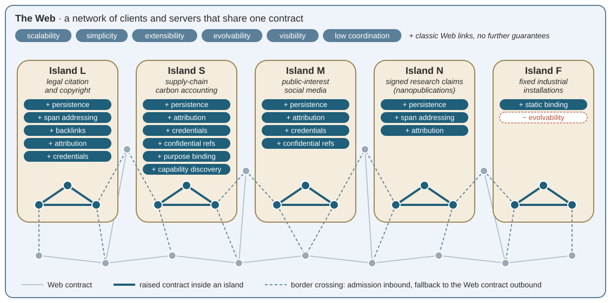

# Part B1 — Full Draft

**Project acronym (working):** ISLANDS
**Project title (working):** A New Web: Bridging NFPs for Heterogeneous
Societal Requirements <!-- was: ...Heterogeneous Requirements -->
**Descriptive subtitle (retained):** Bounded Information Spaces with
Chosen Guarantees — Rebalancing the Web/Xanadu Trade-off for High-Stakes
Information
**PI:** Prof. Dr. Simon Mayer
**Host institution:** University of St. Gallen (USG)
**Duration:** 60 months, indicative start **1 May 2028** (grant
agreement signature scheduled for 8 April 2028; M1 = May 2028, M60 =
April 2033) · **Requested budget:** **[TODO: pending the budget
decision in the Resources and Time Commitment section]** (CoG max €2.0M
plus up to €1.0M additional)
**Primary panel:** PE6 (Computer Science and Informatics)
**Cross-panel relevance:** SH2 (institutions, governance, law)

> Drafting rules honored throughout: B1 is evaluated alone at Step 1 —
> no cross-references to B2, no feasibility detail (feasibility is
> Step 2 only); the synopsis presents idea, state of knowledge,
> objectives, and overall research strategy. B2 = Part II of the
> Scientific Proposal (**7 pages**: implementation & methodology incl.
> feasibility, risk assessment, mitigation) + ongoing-grants annex;
> the separate Resources and Time Commitment section (≤2 pages,
> `draft/resources-and-time-commitment.md`) carries the budget; host support letter and PhD certificate (+
> defense-date evidence if needed) accompany. Guiding maxim from the
> ERC info sessions (`sources/`): *impress non-experts in B1, convince
> experts in B2* — write b.1–b.6 for generalists, mirror the Work
> Programme's own evaluation vocabulary, and lead with the ambition of
> the idea. Page budgets are marked per section. Items I could not
> know are marked **[TODO]**.

---

## Section a — Abstract and cross-panel explanation (max 1 page)

### Abstract (target ≤ 2,000 characters)

<!-- was (before PI edit in B1.docx and closing statement, 2026-10-29):
The Web scaled by giving up stable references, versioning, and
bidirectional links. This trade-off now fails where information
carries consequences: more than half the URLs UK ministers gave
Parliament from 1997 to 2006 had stopped resolving by 2007; a
fabricated audio clip of a party leader circulated, unverifiable,
during Slovakia's 2023 pre-election silence; courts in Europe and
beyond have seen over 1,200 filings with AI-fabricated citations that
no architecture could check; and copyright litigation from Munich to
New York reconstructs attribution trails the Web never recorded. The
coordination cost the Web avoided was deferred, and society now pays
it one incident at a time.

ISLANDS builds a new Web organized around *non-functional properties*
(NFPs). We introduce *islands*: bounded information spaces whose
members choose the NFPs their stakes demand and provide them jointly,
while islands interoperate with each other and with the open Web
through the Web's existing low-coordination mechanisms. Within an
island, we restore the NFPs Xanadu specified (immutable versions,
span-level addresses, traceable transclusion) and add two that
neither architecture anticipated: confidentiality-preserving
references, resolved through secure multi-party computation, that let
members verify a value derived from data they may not read; and
capability discovery that shows autonomous agents which actions are
currently valid. The scientific core is a *theory of chosen
guarantees*, which predicts which NFP bundles an island of a given
size, stake, and threat model can hold, at what coordination cost,
and for which stakeholders. We embody the theory in a reference
architecture and validate it in legal citation and in
cross-organizational supply-chain data, two domains in which our team
runs systems today.
-->
<!-- was (Claude version, 2026-10-29, before PI rewrite in B1.docx):
The World Wide Web scaled to billions of users because its
architecture gave up stable references, versioning, and bidirectional
links. The downsides of this trade-off show wherever information has
consequences: a fabricated audio clip of a party leader circulated,
unverifiable, during Slovakia’s 2023 pre-election silence; over half
the URLs UK ministers gave Parliament in 1997–2006 no longer resolved
by 2007; courts in Europe and beyond have received over 1,200 filings
with AI-fabricated citations; and copyright courts in Munich and New
York must reconstruct attribution trails the Web never recorded. The
Web’s architecture deferred the cost of coordination, and society now
pays it.

ISLANDS extends today’s Web with an architecture organized around
*non-functional properties* (NFPs). *Islands* are bounded information
spaces whose members choose the NFPs their context demands and provide
them jointly, while islands interoperate with each other and the open
Web through its existing low-coordination mechanisms. Within an
island, NFPs such as persistence, precise citation, and attribution
are restored through immutable versions, span-level addresses, and
traceable transclusion. We add two new NFPs: confidentiality-
preserving references, resolved through secure multi-party
computation, that let members verify a value derived from data they
may not read; and capability discovery that shows autonomous agents
which actions are valid. The scientific core is a *theory of chosen
guarantees* that predicts which NFP bundles an island of a given size,
stake, and threat model can hold, at what coordination cost, and for
whom. We embody the theory in a reference architecture and validate it
in legal citation and cross-organizational supply-chain data, where
our team runs systems today. Our theory and open reference
architecture will give society a Web whose guarantees are chosen by
the communities that depend on them, and on which courts, parliaments,
and markets can rely.
-->
<!-- was: because of architectural decisions (trim to stay under 2,000 characters) --><!-- was: over half the URLs UK ministers gave Parliament in 1997–2006 -->
<!-- was (before abstract update to the WP restructuring, 2026-11-05): The World Wide Web scaled to billions of users through architectural decisions that gave up stable references, versioning, and bidirectional links. The downsides of this trade-off show today, when information conveyance has societal consequences: a fabricated audio clip of a party leader circulated, unverifiable, during Slovakia’s 2023 pre-election silence; over half the URLs in UK parliamentary answers of 1997–2006 no longer resolved by 2007; courts in Europe and beyond have received over 1,200 filings with AI-fabricated citations; and copyright courts from Munich to New York must reconstruct attribution trails the Web never recorded. The Web’s architecture hence deferred, rather than avoided, the cost of coordination, and society now pays it. ISLANDS extends today’s Web with an architecture organized around *non-functional properties* (NFPs). *Islands* are bounded networked information spaces whose members choose the NFPs their context demands and provide them jointly. Within an island, NFPs such as *persistence*, *confidentiality-preserving references*, and *attribution* are restored through *immutable versions*, *secure-multi-party-computation-based resolution*, and *traceable transclusion*. Across islands, we establish interoperability through the open Web's existing low-coordination high-scalability mechanisms, thereby also guaranteeing backwards-compatibility with today’s World Wide Web. The scientific core of ISLANDS is a *theory of chosen guarantees* that predicts which NFP bundles an island of a given size, stake, and threat model can hold at what coordination cost. We develop this theory, embody it in a reference architecture, and validate it in legal citation, cross-organizational supply-chain, and online social media use cases, where our team has most experience. Our theory and open reference architecture will give society an extended Web whose guarantees are chosen by individual user communities that require them, and on which courts, parliaments, and markets can rely. -->

<!-- was (before porting the PI restructuring in B1.docx, 2026-11-11): The World Wide Web scaled to billions of users through architectural
decisions that gave up stable references, versioning, and
bidirectional links. Its downsides show today, where information has
societal consequences: a fabricated audio clip of a party leader
circulated, unverifiable, during Slovakia’s 2023 pre-election silence;
over half the URLs in UK parliamentary answers of 1997–2006 no longer
resolved by 2007; courts in Europe and beyond have received over 1,200
filings with AI-fabricated citations; and copyright courts from Munich
to New York must reconstruct attribution trails the Web never
recorded. The Web’s architecture hence deferred, rather than avoided,
the cost of coordination, and society now pays it.

ISLANDS extends today’s Web with an architecture organized around
*non-functional properties* (NFPs). *Islands* are bounded networked
information spaces whose members choose the NFPs their context
requires and provide them within the island, while islands are kept
interoperable and backwards-compatible through today’s Web’s
low-coordination architecture. With affected communities, we first
establish which islands society requires, starting from legal citation and copyright, supply-chain carbon accounting, public-interest social media,
signed research claims, and fixed industrial installations. We then
derive the link classes these islands need, from *immutable,
span-addressed versions* to references resolved through *secure
multi-party computation*, and research how NFPs can translate at island borders. Our scientific core is a *theory
of chosen guarantees* predicting which NFP bundles an island of a
given size and threat model can hold, at what coordination cost. We
embody it in an open reference architecture and validate it with each
island's community. Together, this theory and architecture will give
society an extended Web whose guarantees are chosen by the communities
that require them, and on which courts, parliaments, and markets can
rely. -->

<!-- was (before PI edit in B1.docx): The World Wide Web scaled to billions of users through architectural decisions that gave up stable references, versioning, and bidirectional links. Its downsides show today, where information has societal consequences: a fabricated audio clip of a party leader circulated, unverifiable, during Slovakia’s 2023 pre-election silence; over half the URLs in UK parliamentary answers of 1997–2006 no longer resolved by 2007; a platform's EU transparency report was silently replaced with a corrected version six months after publication, through an updated hyperlink; and copyright courts from Munich to New York must reconstruct online attribution trails. The Web’s architecture hence deferred, rather than avoided, the cost of coordination, and society now pays it. -->
The World Wide Web scaled to billions of users through architectural
decisions that gave up stable references, versioning, and
bidirectional links. Its downsides show where information has societal
consequences: a fabricated audio clip of a party leader circulated,
unverifiable, during Slovakia’s 2023 pre-election silence; over half
the URLs in UK parliamentary answers of 1997–2006 no longer resolved
by 2007; a platform's EU transparency report was silently replaced
with a corrected version six months after publication, through an
updated hyperlink; and copyright courts from Munich to New York must
reconstruct online attribution trails. *The* *Web’s architecture hence
deferred, rather than avoided,* *the cost of coordination, and society
now pays* *it.*

ISLANDS extends today’s Web with an architecture organized around
*non-functional properties* (NFPs). *Islands* are bounded networked
information spaces whose members choose the NFPs their context
requires and provide them within each space, while islands are kept
interoperable and backwards-compatible through today’s Web’s
low-coordination architecture. With affected communities, we first
establish which islands society requires, starting from legal citation
and copyright, supply-chain carbon accounting, public-interest social
media, signed research claims, and fixed industrial installations. We
then derive the link classes these islands need, from *immutable,
span-addressed versions* to references resolved through *confidential
links*, and research how NFPs can translate at island borders. In
addition to an open reference architecture and implementation that we
validate with each island’s community, we provide a *theory of chosen
guarantees* predicting which NFP bundles an island of a given size and
threat model can hold, at what coordination cost. Together, our
architecture and theory will give society an extended Web whose
guarantees are chosen by the communities that require them, and on
which courts, parliaments, and markets can rely.

### Cross-panel / interdisciplinary explanation

The proposal is computer-systems research and is submitted to **PE6
(Computer Science and Informatics)**. It spans four PE6 descriptors:
PE6_10 (Web and information systems) as its core, PE6_2 (distributed
systems), PE6_5 (cryptology, security, privacy; the confidential references and border checks of O3 and O4), and PE6_7 (artificial intelligence, intelligent systems, multi-agent systems; the agent layer of O4).<!-- was: PE6_5 (cryptology, security, privacy; the SMPC reference resolution of O3), and PE6_7 (artificial intelligence, intelligent systems, multi-agent systems; the agent affordance layer of O4). --> We
expect the scientific contribution to lie in the composition, which
none of these sub-fields produces by itself.<!-- was: none of these sub-fields has produced alone. (PI edit in B1.docx) -->

Two validation domains and one objective also engage legal and
governance scholarship (**SH2**, descriptor SH2_4, legal studies): we
design the legal-citation island with legal practice and the
social-media island against the data-access and transparency duties of the Digital Services Act, the interoperability duties of the Digital Markets Act, and the forthcoming Digital Fairness Act,<!-- was: transparency duties of the Digital Services Act, --> and the stakeholder analysis (O1, O5) builds on<!-- was (2026-10-31): the stakeholder/incentive analysis (O5) builds on --><!-- was: One validation domain and one objective also engage legal and
governance scholarship (**SH2**, descriptor SH2_4, legal studies): we
design the legal-citation island with legal practice and evaluate it
against it, and the stakeholder/incentive analysis (O5) builds on -->
legal scholarship on architecture as regulation, on RFC 9518's
centralization analysis, and on the PI's published work on DSA
auditing and transparency regulation. The same analysis covers the business models, costs, and incentives that sustain each island, so that the proposal is interdisciplinary in its assessment of the islands while its methods and deliverables remain in computer science. External SH2 expertise, including on the economics of institutions, would sharpen the assessment of O1 and O5;<!-- was: The business and economic analysis of the islands (O1, O5), i.e., their business models, costs, and incentives, also engages SH1 (individuals, markets, and organisations). SH2 and SH1 expertise would sharpen the assessment of O1 and O5; --><!-- was: SH2 expertise would sharpen the assessment of O1 and O5; --><!-- was: assessment of O5; --> the methods and deliverables are PE6, and SH2 is flagged as the only secondary panel.<!-- was: and SH2 and SH1 are flagged as secondary. --><!-- was: and SH2 is flagged as secondary. -->

---

## Section b — Extended synopsis (max 5 pages)

### b.1 The problem and the idea (~1.5 pages)

<!-- was (before porting the PI restructuring in B1.docx, 2026-11-11): The World Wide Web's original design favored simplicity, decentralization, and low coordination overhead, which enabled explosive adoption but sacrificed stable references, built-in versioning, and native bidirectional linking. The hypertext community had debated all three as core issues from 1988 to 1992 [1, removed: n2]. This was a deliberate
choice: Berners-Lee's 1989 proposal required that the system "allow existing systems to be linked together without requiring any central control or coordination" [3]. When Fielding and Taylor later defined the Representational State Transfer (REST) architectural style, they clarified the trade-offs that the resulting architecture yields: scalable component interactions, uniform interfaces, independently deployable components, and intermediaries that can be inserted anywhere [4]. These priorities suited early document-sharing systems
and enabled the Web’s scaling up to billions of users and devices
within three decades. We argue that the Web’s trade-offs are, however, too rigid for today’s use cases. Publishers require traceable dereferencing, supply chain management requires aggregation over confidential data, and courts and parliaments require stable, specific citations. Users require sovereignty over their data, and society requires trusted content and accountable authorship.

Over the past twenty years, we have kept the Web’s architecture
fundamentally static and such properties lacking; however, platforms
have responded: Accounts, persistent storage, search, reputation, payment, and a consistent shared state do not exist between independent Web sites. Platforms provide them inside proprietary stores into which they draw the Web's content, users, and interactions [removed: n7, removed: n8, 6], and they extend into the rest of the Web through APIs and plug-ins on their own terms [7]. Users then rebuild continuity
themselves through reposts, screenshots, and off-platform link hubs
[8], yielding unsatisfactory mitigation. Berners-Lee warned in 2010
that social networks were walling off the information their users
posted [9], and RFC 9518 describes the general mechanism: functions
built on open protocols still centralize through network effects and
switching costs [10]. The consequences reach the public sphere:
Engagement-optimized ranking amplifies some political content over other content [11]. The EU's Digital Services Act now obliges the largest platforms to assess such systemic risks and to open their data to vetted researchers [12]. This obligation remains hard to operationalize, because researchers must specify data whose existence they cannot observe [13]. The Commission's first fine under the Act,
€120 million against X in December 2025, concerned a "verified" badge
that anyone could buy without an identity check and terms that barred
researchers from public data [removed: n15]. The Web itself authenticates
domains through TLS certificates, but it offers no native way to state
verifiably who stands behind a document or an account, or what
qualifies them [42]. The W3C now lists among its Ethical Web
Principles that the Web "makes it possible to verify information",
since "the public needs verifiable source and context information to
recognize trustworthy web publishers and content" [64]. Even the data
that platforms do release differs from what their users see [14, removed: n18].
It can also change silently. In August 2026, six months after publication, TikTok repointed the download link of its DSA transparency report to a corrected version without announcement; the correction lowered the reported terrorist-content notices from 77,729 to 43,119 [15]. Press publishers face the same opacity. In October 2026, the Paris Court of Appeal upheld an order that Meta negotiate neighboring-rights payments with French media in good faith; it found that Meta had supplied only fragmentary, opaque, and unverifiable data on its use of their content [16]. Legal scholarship treats such
architectural choices as regulation in their own right [removed: n22, removed: n23, 104].
Generative AI now repeats the pattern: answer engines and agentic browsers return answers in place of links and so control access to the Web's content [17]. The W3C Technical Architecture Group (TAG), in contrast, holds that a user agent acting on its user's behalf owes "meaningful visibility into the sources it relied on" [18]. Highlighting real-world consequences, Reddit announced in
October 2026 a move to a primarily logged-in experience, to protect
its data from scraping [19] after AI answers cut its search referrals
by more than a million per week. This shows that, today, the
properties that high-stakes communities require are available, but
inside closed platforms and under these platforms’ control – hardly an
Open Web.

Society pays for these omissions: In 2007, the UK government found that more than half of the roughly 4,000 URLs cited in ministerial answers to Parliamentary Questions since 1997 no longer resolved, and it built a redirect service into its national Web archive in response [20]. One in five scholarly articles cites Web content that has since rotted [21]. Two days before Slovakia's 2023 election, a fabricated recording
of a party leader discussing vote-rigging circulated with no
provenance that voters could check [23]. From February 2027, batteries
sold in the EU (and, soon after, products from clothes to detergents)
must carry a digital passport with carbon-footprint and due-diligence
data assembled from suppliers along the chain [24]. Law shows the cost
most sharply, because there a reference's stability is part of the
claim it supports. The EU has given judgments and legislation
persistent identifiers through ELI [27, 28], but these name documents,
not cited passages or versions; half the URLs cited in U.S. Supreme
Court opinions no longer resolve, and Perma.cc archives cited pages
one citation at a time [62]. By early 2026, more than 1,200 court decisions worldwide concerned AI-fabricated citations [removed: n26]. The High Court of England and Wales warned that citing fabricated authorities may lead to referral to the regulator or to contempt proceedings [removed: n36]. Content provenance is being moved into camera
hardware [29] and into EU law [30, 12], and the Munich Regional Court
held in November 2025 that a language model's memorization of song
lyrics infringes copyright [32], a similar question to what *The New*
*York Times v. OpenAI* is litigating in the U.S. [34, removed: n39]. *What the
cases have in common is that coordination cost that the Web avoided
was deferred, not eliminated; society now pays it* *piecemeal,*
*one incident at a time.*

**Why now.** Building these properties into the architecture pays
off today, where it did not in 1989. First, the coordination they
require has become far less costly. Content addressing [48],
*verifiable credentials*, a W3C Recommendation since 2025 [42], and
practical *secure multi-party computation* [49] are standardized and
deployed, and every EU Member State must offer a European Digital
Identity Wallet by 24 December 2026 [41]. Second, demand for the same
guarantees now arrives from many directions at once. The DSA requires
attribution and research access [12], the Data Act portability [50], the AI Act respect for machine-readable reservations against text and data mining [35], and the battery passport and CBAM verifiable supply-chain data
[24, 51]. Today, every platform implements each of these
obligations separately, and every regulator checks them separately:
N platforms and M obligations yield N × M integrations. An
architecture specifies each obligation once, as an NFP bundle, and
lets each platform implement it once, which turns N × M into N + M.
Third, platform-level solutions fail visibly. A platform can withdraw
or silently change what it offers, as the cases above show, and
machines, which now produce most Web traffic [52], cannot check a
platform's promises. Finally, the protocols that will carry these
guarantees are being standardized now, in the W3C groups on the
social Web, storage, credentials, and agents and in agent protocols
such as MCP [55] and x402 [56]. Once they settle, the opportunity to
build the guarantees in closes, as it did in the 1990s.

**The idea.** ISLANDS proposes to *extend* today’s Web’s architecture and build selected properties into the Web itself. Communities that require these properties can then select their *own property configuration*, i.e., a set of desired *non-functional properties* (NFPs) that apply to their part of the Web. Such communities are not small. One example is the *copyright community*, i.e., all stakeholders with an interest in having content rights preserved by the architecture, from authors and publishers to collecting societies and courts. Another is an industry's supply chain that must account for its carbon emissions. *Islands* are bounded networked information spaces, such as a legal-citation community, a supply chain that accounts for its carbon emissions, or a community of public-interest publishers on social media. Their members share stakes high enough to justify the cost of coordination, and they settle it through an ex-ante selected architectural trade-off rather than ex-post patching or litigation. *The New York Times*, for instance, is litigating the use of its articles by AI models [33]. It could choose to publish its articles into an island whose NFPs bind every quotation to its source through traceable *transclusion* and carry the paper's reservation against text and data mining [34, 35] in each reference.
Readers and AI models that accept these terms enter the island. A
paywall achieves less: it controls access on one platform, and once an
article has been read, its quotations and copies leave without terms
or provenance. In the island, the terms and the attribution travel
with every quotation to every participating site and agent, and reuse
becomes verifiable without any single platform controlling the
articles. Each island selects the NFPs its stakes demand and
provides them jointly within its scope, while islands interoperate
with one another and with the open Web through the Web's existing
low-coordination mechanisms that permit planetary scaling. Within an island, references can for instance be span-level, version-pinned, bidirectional, and verifiable, similar to how Xanadu specified them [37, removed: n43]. Across the boundary, they degrade to ordinary Web links, so that every island remains backwards-compatible with today's Web. Islands can also move away from the Web in the opposite direction. An island of fixed, high-speed installations may bind its interfaces once, at design time, in a binary encoding, much as a linker resolves a program's symbols when it builds the program [29, 30]. Entering an island is an explicit admission step: a client, human
or agent, is shown the island's NFP set and accepts the obligations of
membership, and this is where the island applies its attribution
regime. Through ISLANDS, we further explore NFPs that have not yet
been proposed on an architectural level. These include
*confidentiality-preserving references* that resolve to a value that
members can verify was correctly derived from data they may not read;
this generalizes *secure multi-party computation* (SMPC), which has
run in production since 2008 [39, removed: n46]. They also include *purpose
binding* which attaches the terms of a disclosure (recipient, purpose,
validity window) to the reference, so that a reference is re-resolved
when its terms expire [39]. *Attribution* binds a reference to an
accountable author or, through anonymous credentials and the
pseudonyms the European Digital Identity Wallet must support, to an
eligible but unidentified one [removed: n48, 41, 42]. *Verifiable credentials*
let a reference carry an issuer's attested claim about its source,
e.g., that a filing was signed by a member of the bar or that an
emissions figure was checked by an accredited verifier [43, removed: n52].
*Capability discovery* shows agents, after each interaction, only the
actions currently valid, in the hypermedia style of REST [2] as
extended to multi-agent systems [44, removed: n54, 45]; current LLM agents
instead receive statically linked tool catalogues [55, removed: n98]. The
unifying scientific contribution is a *theory of chosen guarantees*: a
formal account of which NFP bundles an island can provide, at which
coordination cost, under which threat model, and for which
stakeholders. Neither hypertext research nor Web engineering offers
this today (b.2).

Figure 1 shows five example islands within the Web. Each island is a part of the Web's network whose clients and servers raise the contract that the Web offers with the NFPs that their community requires. As an example, *Island L* lets a court or author cite a passage that resolves to exactly the version relied on, and it makes a fabricated citation fail visibly. It leaves a trail of reuse that a copyright dispute, or any scheme that remunerates reuse, can follow, and it makes terms such as a rightholder's reservation against text and data mining [34, 35] verifiable in the reference. It does not, however, establish that a cited source is correct, and it records no reuse that happens outside the island. *Island S* lets suppliers report
confidential emission figures that can be checked without decryption;
*Island M* lets readers see who stands behind an account and how a
post was edited or deleted, and lets researchers obtain exposure
statistics; *Island N* keeps signed, content-hashed research claims, as published in the deployed nanopublication network [removed: n57, 47, 48], citable and attributed. It ties each claim through span addressing to the specific passage of the source on which it rests. *Island F*, finally, lets fixed installations interact over binary interfaces at low latency while giving up evolvability.

*Figure 1. Five example islands within the Web. The Web is a network
of clients and servers that share one contract with its own NFPs
(top); outside any island, references are classic Web links without
further guarantees (thin links). Each island is a part of this network
whose members raise the contract by adding NFPs (filled), so that
links inside the island carry stronger guarantees (thick links).
Island F, the downgrade island, trades evolvability for static
binding. Links that cross an island's border pass admission inbound
and fall back to the Web contract outbound (dashed). These are the
island drafts that the project solidifies and uses as requirements
documents for its architecture.* -->

<!-- was (before PI edit in B1.docx): The World Wide Web's original design favored simplicity, decentralization, and low coordination overhead, which enabled explosive adoption but sacrificed stable references, built-in versioning, and native bidirectional linking [1, removed: n2, 2]. This was a deliberate choice: Berners-Lee's 1989 proposal required that the system "allow existing systems to be linked together without requiring any central control or coordination" [3]. When Fielding and Taylor defined the Representational State Transfer (REST) architectural style, they clarified the resulting architectural constraints: scalable component interactions, uniform interfaces, independently deployable components, and intermediaries that can be inserted anywhere [4]. These constraints enabled the Web’s scaling up to billions of users and devices within three decades. We argue that the Web’s trade-offs have, however, become too rigid for today’s use cases. Today, publishers require traceable dereferencing, courts and parliaments require stable, specific citations, supply chains require aggregation over confidential data, users should retain sovereignty over their data, and society requires trusted content and accountable authorship. These needs should be satisfied in a way that is backwards-compatible with today’s Web. -->
The World Wide Web's original design favored simplicity,
decentralization, and low coordination overhead, which enabled
explosive adoption but sacrificed stable references, built-in
versioning, and native bidirectional linking [1, 2]. This was a
deliberate choice: Berners-Lee's 1989 proposal required that the
system "allow existing systems to be linked together without requiring
any central control or coordination" [3]. When Fielding and Taylor
defined the Representational State Transfer (REST) architectural
style, they clarified the resulting architectural constraints:
scalable component interactions, uniform interfaces, independently
deployable components, and intermediaries that can be inserted
anywhere [4]. These constraints enabled the Web’s scaling up to
billions of users and devices within three decades. We argue that the
Web’s trade-offs have, however, become too rigid for today’s use
cases. Today, publishers require *traceable* dereferencing, courts and
parliaments require *stable, specific* citations, supply chains
require aggregation over *confidential* data, users should retain
*sovereignty* over their data, and society requires *trusted* content
and *accountable* authorship. These needs should be satisfied
*architecturally*, but in a way that is backwards-compatible with
today’s Web.

<!-- was (before PI edit in B1.docx): While we have kept the Web’s architecture fundamentally static, platforms have responded: Accounts, persistent storage, search, reputation, and payment do not exist between independent Web sites, but platforms provide them inside their “walled gardens” [5] into which they draw the Web's content, users, and interactions [6], and they extend into the rest of the Web through APIs and plug-ins on their own terms [7]. Users then rebuild continuity through archives, reposts, and off-platform link hubs [8]. Berners-Lee warned already in 2010 that social networks were walling off information their users posted [9], and RFC 9518 describes how functions built on open protocols still centralize through network effects and switching costs [10]. The consequences are borne by society: Engagement-optimized ranking amplifies some political content over other content [11], one of several systemic risks that the EU's Digital Services Act (DSA) attempts to address, with limited success [12, 13, 14]. The data that platforms do release may change silently: in August 2026, six months after publication, TikTok repointed the download link of its DSA transparency report to a corrected version without announcement; the correction lowered the reported terrorist-content notices from 77,729 to 43,119 [15]. Press publishers face the same opacity: in October 2026, the Paris Court of Appeal found that Meta had supplied only fragmentary, opaque, and unverifiable data on its use of their content and upheld an order that Meta negotiate neighboring-rights payments with French media in good faith [16]. And generative AI assistants, running on essentially the same information system architecture that was created for human researchers in the 1990s, now repeat and amplify the pattern: chatbots and agentic browsers return answers in place of links and so control access to the Web's content [17] while the W3C's Technical Architecture Group (TAG) argues that a user agent acting on its user's behalf owes "meaningful visibility into the sources it relied on" [18]. And Reddit, which is designated as a Very Large Online Platform (VLOP) under the DSA, announced in October 2026 a move to a primarily logged-in experience, to protect its data from scraping [19] after AI answers cut its search referrals by more than a million per week. This shows that, today, the properties that high-stakes communities require are available, but they are provided inside closed platforms and under these platforms’ control: walled gardens instead of an open Web. -->
While we have kept the Web’s architecture fundamentally static,
*platforms* have responded: Accounts, persistent storage, search,
reputation, and payment do not exist between independent Web sites,
but platforms provide them inside their “walled gardens” [5] into
which they draw the Web's content, users, and interactions [6], and
they extend into the rest of the Web through APIs and plug-ins on
their own terms [7]. Users then rebuild continuity through archives
and off-platform link hubs [8]. Berners-Lee warned already in 2010
that social networks were walling off information their users posted
[9], and RFC 9518 describes how functions built on open protocols
*still centralize* through network effects and switching costs [10].
The consequences are borne by society: Engagement-optimized ranking
amplifies some political content over other content [11], one of
several systemic risks that the EU's Digital Services Act (DSA)
attempts to address, with limited success [12, 13, 14]. The data that
platforms do release may change silently: in August 2026, six months
after publication, TikTok repointed the download link of its DSA
transparency report to a corrected version without announcement; the
correction lowered the reported terrorist-content notices from 77,729
to 43,119 [15]. Press publishers face the same opacity: in October
2026, the Paris Court of Appeal found that Meta had supplied only
fragmentary, opaque, and unverifiable data on its use of their content
and upheld an order that Meta negotiate neighboring-rights payments
with French media in good faith [16]. And generative AI assistants,
running on essentially the same information system architecture that
was created for human researchers in the 1990s, now repeat and amplify
the pattern: chatbots and agentic browsers return answers in place of
links and so control access to the Web's content [17], while, according
to the W3C's Technical Architecture Group (TAG), a user agent acting on
its user's behalf owes "meaningful visibility into the sources it
relied on" [18]. And Reddit, a Very Large Online Platform (VLOP) under
the DSA, announced in October 2026 that it is moving to a logged-in experience to
protect its data from scraping [19] after AI answers cut its referrals
by more than a million per week. This shows that, today, the
properties that high-stakes communities require are available, but
they are provided inside closed platforms and under these platforms’
control: walled gardens instead of an open Web.

<!-- was (before PI edit in B1.docx): Society pays for these architectural omissions: Web references point to locations whose content may change or vanish, requiring workarounds; for instance, the UK government has created a redirect service in response to finding that more than half of the roughly 4,000 URLs cited in ministerial answers to Parliamentary Questions since 1997 no longer resolved [20]; one in five scholarly articles cites Web content that has since rotted [21], necessitating archival infrastructure such as Zenodo [22]. The Web does not bind content to its author: two days before Slovakia's 2023 election, a fabricated recording of a party leader discussing vote-rigging circulated with no provenance that voters could check [23]. The Web’s architecture does not support publishing verifiable aggregates over private data, yet the EU now requires exactly this from its core industries. From February 2027, every electric-vehicle and large industrial battery sold in the EU must carry a digital battery passport with its carbon footprint and supply-chain due diligence [24]. The Ecodesign for Sustainable Products Regulation (ESPR) extends such digital product passports to nearly all products on the single market, starting with steel in 2026 and textiles in 2027 [25, 26]; a passport must stay available if its issuer disappears and must give different actors different access to its data [25]. Imports of steel, aluminum, cement, and fertilizers must, in turn, declare their verified embedded emissions under the Carbon Border Adjustment Mechanism [51]. Web links address whole resources, not passages or versions of pages, while in law references need to be specific and stable; the EU therefore created persistent identifiers for judgments and legislation through ECLI and ELI [27, 28]. Because the Web records no provenance, content provenance is being moved into other places, from camera hardware [29] to EU law [30, 12]. Finally, the Web affords copying content instead of transcluding it [31], hence reuse by third parties leaves no trail; this ultimately leads to the Munich Regional Court holding in November 2025 that a language model's memorization of song lyrics infringes copyright [32], a similar question to what The New York Times v. OpenAI is currently litigating in the U.S. [33]. What all these cases have in common is that coordination cost that the Web avoided was deferred, not eliminated; society now pays for this architectural misalignment, one incident at a time. -->
Society pays for these architectural omissions: Web references point
to locations whose *content may change or vanish*, requiring
workarounds; for instance, the UK government has created a redirect
service in response to finding that more than half of the roughly
4,000 URLs cited in ministerial answers to Parliamentary Questions
since 1997 no longer resolved [20]; one in five scholarly articles
cites Web content that has since rotted [21], necessitating archival
infrastructure such as Zenodo [22]. The Web *does not bind content to
its author*: two days before Slovakia's 2023 election, a fabricated
recording of a party leader discussing vote-rigging circulated with no
provenance that voters could check [23]. The Web’s architecture does
*not support publishing verifiable aggregates over private data*, yet
the EU now requires exactly this from core industries. From February
2027, every electric-vehicle and large industrial battery sold in the
EU must carry a *digital battery passport* with its carbon footprint
and supply-chain due diligence [24]. The Ecodesign for Sustainable
Products Regulation (ESPR) extends such *digital product passports* to
nearly all products on the single market, starting with steel in 2026
and textiles in 2027 [25, 26], and passports must stay available if
their issuers disappear [25]. Web links *address whole resources*, not
passages or versions of pages, while in law references need to be
specific and stable; the EU therefore created persistent identifiers
for judgments and legislation through ECLI and ELI [27, 28]. Because
the Web *records no provenance*, content provenance is being moved
into other places, from camera hardware [29] to EU law [30, 12].
Finally, the Web *affords copying content* instead of transcluding it
[31], hence reuse by third parties leaves no trail; this ultimately
leads to the Munich Regional Court holding in November 2025 that a
language model's memorization of song lyrics infringes copyright [32],
a similar question to what *The New York Times v. OpenAI* is currently
litigating in the U.S. [33]. *What all these cases have in common is
that coordination cost that the Web avoided was deferred, not
eliminate**d; society now pays for this architectural misalignment**,
one incident at a time.*

<!-- was (before PI edit in B1.docx): The Idea. ISLANDS proposes to extend today’s Web’s architecture and build selected properties into the Web itself. Communities that require these properties can then select their own property configuration, i.e., a set of desired non-functional properties (NFPs) that apply to their part of the Web. One example of such a community is the copyright community, i.e., all stakeholders with a pronounced interest in having content rights preserved by the architecture, from authors and publishers to courts. Another is an industry that needs to account for carbon emissions along its supply chain, which requires the architectural preservation of confidentiality of individual business data while aggregates are published and verified. We define islands as bounded networked information spaces that cater to such communities with explicitly selected NFPs. An island’s members share stakes high enough to justify the cost of architectural coordination, and they settle it through an ex-ante selected architectural trade-off rather than ex-post patching, fragmentation through platformization, or litigation. With ISLANDS, The New York Times, for instance, could choose to publish its articles into an island whose NFPs bind every quotation to its source through traceable linking and that constrain text and data mining [34, 35]. Readers and AI agents that accept these terms enter the island, where terms and attribution travel with every quotation to every participating site and agent, and reuse becomes verifiable. Copying a quotation out of the island remains possible, since islands do not restrict reading or copying (Section 2), but the copy leaves the island's guarantees behind: it no longer verifies against its source, so readers, courts, and agents can tell it apart from an attributed quotation. With today’s non-architectural alternative, i.e., platformization and paywalling as Reddit did in response to AI agents, control is confined to individual platforms, and once an article has been read, its quotations and copies leave without terms or provenance. -->
**The Idea.** ISLANDS proposes to *extend* today’s Web’s architecture
with specific architectural guarantees. Communities that require these
guarantees can then select their *own property configuration*, i.e., a
set of desired *non-functional properties* (NFPs) that apply to their
part of the Web. One example of such a community is the *copyright
community*, i.e., all stakeholders with a pronounced interest in
having content rights preserved by the architecture, from authors and
publishers to courts. Another is an industry that needs to account for
carbon emissions along its supply chain, which requires the
architectural preservation of confidentiality of *individual business
data* while *aggregates* are published and verified. To enable this
extension, we define *islands* as bounded networked information spaces
that cater to such communities with explicitly selected NFP bundles.
An island’s members share stakes high enough to justify the cost of
architectural coordination, and they settle it through an ex-ante
selected architectural trade-off rather than ex-post patching,
fragmentation through platformization, or litigation. With ISLANDS,
*The New York Times*, for instance, could choose to publish its
articles into an island whose NFPs bind every quotation to its source
through traceable linking and that constrain text and data mining [34, 35]. Readers and AI agents that accept these terms enter the island,
where terms and attribution travel with every quotation to
participating sites and agents, and reuse becomes verifiable. Copying
a quotation out of the island remains possible, since islands do not
restrict reading or copying, but the copy leaves the island's
guarantees behind: it no longer verifies against its source, and
readers, courts, and agents can thereby tell it apart from an
attributed quotation. With today’s non-architectural alternative,
i.e., platformization and paywalling, control is confined to
individual platforms, and once an article has been read by an AI agent
or copied by a user, its quotations and copies leave without terms or
provenance.

<!-- was (before PI edit in B1.docx): Each island selects the NFPs its participants require and provides them jointly within its scope, while islands interoperate with one another and with the open Web through the Web's existing low-coordination mechanisms that permit planetary scaling. Within an island, references can for instance be span-level, version-pinned, bidirectional, and verifiable, similar to how Xanadu specified them in the 1980s [37, removed: n43]. Across the boundary, they degrade to ordinary Web links, so that every island remains backwards-compatible with today's Web. The specific NFPs that can be selected within an island are flexible: In ISLANDS, they include confidentiality-preserving references that resolve to a value, such as an aggregate, that members can verify was correctly derived from encrypted inputs. This yields an architectural integration of zero-knowledge proofs [37] and secure multi-party computation (SMPC) [39, removed: n46]. NFPs also include purpose binding, which attaches the terms of a disclosure (e.g., recipient, purpose, validity window) to the reference, so that a reference is re-resolved when its terms expire [39]. Attribution binds a reference to an accountable author or to an eligible but unidentified one through the European Digital Identity Wallet (EDIW) [removed: n48, 41, 42]. Verifiable credentials let a reference carry an issuer's attested claim about its source, e.g., that a filing was signed by a member of the bar or that an emissions figure was checked by an accredited verifier [43, removed: n52]. And capability discovery architecturally extends the Web’s Hypermedia as the Engine of Application State (HATEOAS) principle [2] to artificial agents, as recently demonstrated in the multi-agent systems field [44, removed: n54, 45]. Finally, an island of fixed, high-speed installations may bind its interfaces once, at design time, in a binary encoding, much as a linker resolves a program's symbols when it builds the program [45]. This forgoes the Web’s extensibility and evolvability in exchange for performance, while it follows the same ISLANDS principle of an explicitly selected NFP bundle. Our unifying scientific contribution is hence a theory of chosen guarantees, which is a formal account of which NFP bundles an island can provide in principle, at which coordination cost, under which threat model, and for which stakeholders. -->
Each island selects the NFPs its participants require and provides
them jointly within its scope, while islands interoperate with one
another and with the open Web through the Web's existing
low-coordination mechanisms that permit planetary scaling. *Within* an
island, references can for instance be span-level, version-pinned,
bidirectional, and verifiable, similar to how Xanadu specified them in
the 1980s [36]. *Across* the boundary, they degrade to ordinary
Web links, so that every island remains backwards-compatible with
today's Web. The specific NFPs that can be selected within an island
are flexible: In ISLANDS, we foresee *confidentiality-preserving
references* that resolve to a value, such as an aggregate, that
members can verify was correctly derived from encrypted inputs; this
yields an *architectural integration* of zero-knowledge proofs [37]
and secure multi-party computation (SMPC) [38]. NFPs also include
*purpose binding*, which attaches the terms of a disclosure (e.g.,
recipient, purpose, validity window) to the reference, so that a
reference is re-resolved when its terms expire [39]. *Attribution*
binds a reference to an accountable author or to an eligible but
unidentified one through the European Digital Identity Wallet (EDIW)
[40, 41]. *Verifiable credentials* let a reference carry an
issuer's attested claim about its source, e.g., that a filing was
signed by a member of the bar or that an emissions figure was checked
by an accredited verifier [42]. And *capability discovery*
architecturally extends the Web’s *Hypermedia as the Engine of
Application State* (HATEOAS) principle [2] to cater to artificial
agents, as recently demonstrated in the multi-agent systems field [43, 44]. Finally, an island of fixed, high-speed installations may
bind its interfaces once, at design time, in a binary encoding, much
as a linker resolves a program's symbols when it builds the program
[45]. This forgoes the Web’s extensibility and evolvability in
exchange for performance, while it follows the same ISLANDS principle
of an explicitly selected NFP bundle. Our unifying scientific
contribution is hence a *theory of chosen guarantees*, which is a
formal account of *which NFP bundles an island can provide in
principle, at which coordination cost, under which threat model, and
for which stakeholders*.

<!-- was (before PI edit in B1.docx): Figure 1 shows five example islands within the Web. Each island is a part of the Web's network whose clients and servers modify the Web’s basic contract to support the NFPs that their community requires. As an example, Island L lets a court or author cite a passage that resolves to exactly the version relied on, and it thereby makes a fabricated citation fail visibly. It also leaves a trail of reuse that a copyright dispute, or any scheme that remunerates reuse, can follow, and it makes terms such as a rightsholder’s reservation against text and data mining [34, 35] verifiable in the reference. It does not, however, establish that a cited source is correct, and it records no reuse that happens outside the island. Island S lets suppliers report confidential emission figures that can be checked without decryption; Island M lets readers see who stands behind an account and how a post was edited or deleted, and lets researchers obtain exposure statistics; Island N keeps signed, content-hashed research claims, as published in a nanopublication network [removed: n57, 47, 48], citable and attributed. It ties each claim through span addressing to the specific passage of the source on which it rests. Island F, finally, lets fixed installations interact over binary interfaces at low latency while giving up the Web’s evolvability. -->
Figure 1 shows five proposed islands, embedded in the Web.
Each modifies the Web’s basic contract to support the NFPs that its
community requires. As an example, *Island L* lets a court or author
cite a passage (through *span addressing*) that resolves to exactly
the version relied on (through *persistence*). It also leaves a trail
of reuse (through *backlinks*) that a copyright dispute, or any scheme that
remunerates reuse, can follow, and it makes terms such as a
rightsholder’s reservation against text and data mining [34, 35]
verifiable in the reference (through *attribution* and *credentials*). It does not, however,
establish that a cited source is correct, and it records no reuse that
happens outside the island. *Island S* lets suppliers report
confidential emission figures that can be checked without decryption
(through *confidential references*); *Island M* lets readers see who
stands behind an account and how a post was edited or deleted (through
*persistence*, *attribution*, and *credentials*), and lets researchers obtain exposure
statistics (through *confidential references*); *Island N* keeps
signed, content-hashed research claims, as published in a
nanopublication network [46, 47], citable and attributed (through
*span addressing**, persistence, and attribution)*. *Island F*,
finally, lets fixed installations interact over binary interfaces at
low latency while giving up the Web’s evolvability (through *static
binding*).

*Figure 1. Five example islands within the Web. Outside any island, references are classic Web links without further guarantees (thin links). Within islands, members raise the contract by adding NFPs (filled pills), so that links inside the island carry stronger guarantees (thick links). Links that cross an island's border pass admission inbound and fall back to the Web contract outbound (dashed).*

<!-- was (before PI edit in B1.docx): Possible and Required Now. Building these properties into the architecture did not pay off in 1989, but it does today. First, the coordination required by many of the important NFPs has become far less costly. Content addressing [48], verifiable credentials, a W3C Recommendation since 2025 [42], and practical secure multi-party computation [49] are standardized and deployed, and every EU Member State must offer an EDIW by 24 December 2026 [41]. Second, demand for the same guarantees now arrives from many directions at once. The DSA requires attribution and research access [12], the Data Act portability [50], the AI Act respect for machine-readable reservations against text and data mining [35], and the battery passport and CBAM verifiable supply-chain data [24, 51]. Today, every platform implements each of these obligations separately, and every regulator checks them separately: N platforms and M obligations yield N × M integrations. An architecture specifies each obligation once, as an NFP bundle, and lets each platform implement it once, which turns N × M into N + M. Third, platform-level solutions are failing visibly today. A platform can, as shown above, withdraw or silently change what it offers, and machines, which now produce most Web traffic [52], cannot check a platform's promises; machine “negotiation” relies on crude mechanisms such as robots.txt [53] or recent patches such as the IETF's vocabulary for AI usage preferences [54]. Finally, the protocols that will carry these guarantees are being standardized now, in the W3C groups on the social Web, storage, credentials, and agents and in agent protocols such as MCP [55] and x402 [56]. -->
**Possible and Required Today.** Building these properties into the
architecture did not pay off in 1989, but it does today. First, the
coordination required by many of the important NFPs has become far
less costly. Content addressing [48], *verifiable credentials*, a W3C
Recommendation since 2025 [42], practical *secure multi-party
computation* [49], and *decentralized version control* (through Git),
are standardized and deployed at scale, and every EU Member State must
offer an EDIW since 24 December 2026 [41]. Second, demand for the same
guarantees now arrives from many directions at once. The DSA requires
attribution and research access [12], the Data Act portability [50],
the AI Act respect for machine-readable reservations against text and
data mining [35], and the battery passport and CBAM verifiable
supply-chain data [24, 51]. Today, every platform implements each of
these obligations separately, and every regulator checks them
separately: N platforms and M obligations yield N × M integrations. An
architecture specifies each obligation once, as an NFP bundle, and
lets each platform implement it once, which turns N × M into N + M.
Third, platform-level solutions are failing visibly today. A platform
can, as shown above, withdraw or silently change what it offers, and
machines, which now produce most Web traffic [52], cannot check a
platform's promises; machine “negotiation” relies on crude mechanisms
such as robots.txt [53] or recent patches such as the IETF's
vocabulary for AI usage preferences [54]. Finally, the protocols that
will carry these guarantees are being standardized now, in the W3C
groups on the social Web, storage, credentials, and agents and in
agent protocols such as MCP [55] and x402 [56].

### b.2 State of knowledge and research gap (~0.75 page)

<!-- was (before porting the PI restructuring in B1.docx, 2026-11-11): Hypertext research traditionally assumed rich, span-anchored links (e.g., [37, 57, removed: n69]), and its agenda included versioning and computed structure (e.g., [1]). A link would persist, and it would point at a specific range of bytes rather than a full page. Modifying a link would create a new version instead of replacing the link. Open-hypermedia systems in addition
implemented *bidirectional* links and *referential integrity* at
workgroup scale [58, 59]; link rot had thus been addressed even before
the Web made it endemic. The Web dropped these guarantees to scale [1, 42], and this was a sensible and pragmatic choice at the time.

Since the mid-1990s, when the Internet Archive began to archive the Web [60], remedial infrastructure has kept this architecture and compensated for its drawbacks, such as link rot and misattribution. This infrastructure includes persistent identifier overlays, Web archives, Memento [61], Perma.cc [62], and robust hyperlinks [63], with permanent links such as those of the *Internet Archive's Wayback Machine* or, in the research space, *Zenodo* [22], since link rot undermines reproducibility [21]. Such compensation did not touch the
architectural principles of the Web, since changing them might
fragment what the W3C's Ethical Web Principles call "one web" [64].
W3C specifications address passages and backlinks on the open Web:
*Web Annotation* selectors [65] and *text fragments* [66] identify a
passage of a page, and *Webmention* [67] and *Linked Data
Notifications* [68], which the W3C *Social Web Working Group*
maintains together with *ActivityPub* [69], deliver opt-in backlinks.
None of them, however, pins a version or verifies what it points to,
since this would induce architectural change with undesired side
effects (e.g., it would undermine scalability of the Web). Dedicated
services assemble specific NFP profiles as well, e.g., persistence via
*Perma.cc* or *Zenodo*, provenance via *C2PA* [29], and identity and
notarization via *DOIs* or *blockchains*. *Solid* [72] brings *data
sovereignty*, since users keep their data in personal stores of their
choice; *privacy and access control*, since each application reads
only what the user grants it; and *portability*, since the data is
decoupled from individual applications. Remuneration for reuse
followed a similar path. Xanadu tied *transclusion* to payment, so that
each delivered fragment would earn its owner a royalty, which Nelson
later recast as *transcopyright* [73]. Micropayment schemes
for the Web [74] did not take hold, in part because small
payments impose mental transaction costs on readers [removed: n84]. They now return for machine readers. The status code 402 "Payment Required", reserved in HTTP for decades [75], is used to charge AI crawlers per fetch [76] and agents per request [56]. Cloudflare's Pay Per Use pays publishers for each use of their content that AI companies report themselves [removed: n77]. None of these schemes
rests on a record of use that both sides can verify. These developments are evidence of the demand for chosen guarantees that extend beyond those
of the basic Web architecture. However, each is an individual remedy
that provides one fixed profile, and they do not touch the
architectural foundation of the Web.

Today’s re-decentralization efforts relocate *control* and leave
*addressability* as it was. Solid's pods keep location-addressed,
mutable resources [72], and data spaces relocate contracts and
governance [removed: n88]. Federated social media behaves similarly:
*ActivityPub* distributes servers but keeps posts location-addressed
and mutable [69], and Bluesky's *AT Protocol* signs and
content-addresses each user's repository [removed: n89] but leaves references
between posts unverified and offers one fixed set of guarantees to all
communities. In the regulatory space, EU data law follows the same line: the *Data Act* and the portability rights of the *GDPR* and the *DMA* move *copies of data* between holders [50]. The Solid deployments that implement them (cf. our own [removed: n90, removed: n91]) leave references location-addressed. However, raw-data transfer cannot
sustain a market, hence we have recently seen proposals of trading
*purpose-bound data derivations* whose terms limit their shelf life
and use [39]. There is today no reference layer that could name such a
derivation, pin it to a version, or carry its terms. *Usage control*
formalized such terms [removed: n92, removed: n93], and *sticky policies* bind them to the
data [removed: n94]. Enforcement after release, however, requires a trusted
monitor at the recipient or falls back on detection after the fact
[removed: n93]. RFC 9518 explains why open specifications alone do not prevent
centralization, and we adopt the design-level mitigations it lists
[10]. It is relevant to note that network architecture faced the same
question one layer below. Clark et al. argued that an Internet
embedded in society must leave room for the *tussle* between
stakeholders with conflicting interests, and proposed design for
change and controlled transparency as its tenets [removed: n95, removed: n96]. Plutarch
argued for heterogeneous network contexts joined by translating
functions at their borders [removed: n97]. These positions state principles on
the network layer that mirror the issues we highlight on the
application layer of the World Wide Web, but they concern packets and
network addresses rather than references and information resources.

As a community, we have thus built imperfect remedies instead of an
architected approach. The reason is that an architected approach is
hard: it requires consolidating fields that have so far advanced
separately, namely hypertext, distributed systems, cryptography,
multi-agent systems, and law.

The methods that make such a shift possible today (Section 1) were not available in the early days of the Web: *Content-addressed* and *versioned storage* (Git; IPFS
[48]; Software Heritage identifiers [77]) and *provenance attestation*
[29, 78] now supply, at Web scale, the substrate that Xanadu [37, removed: n43] lacked. ISLANDS takes from Xanadu its traceability of reuse, not control over reading: a quoted passage stays linked to its source, but nothing restricts copying or enforces terms on readers' devices, which separates *islands* from digital rights management. They are, however, storage and signing primitives without span
semantics, a link layer, or a governance model. *Nanopublications* [removed: n57, 47] form a deployed, federated network of immutable, signed semantic statements with self-verifying identifiers. They do not, however, offer span addressing over arbitrary content, *transclusion*, or confidentiality-preserving resolution. From the perspective of this proposal, nanopublications may become an *island* at statement granularity (Island N in Figure 1). With respect to who may see,
trust, and act on the Web, too, the building blocks exist but are not
part of the Web's architecture. With respect to confidentiality,
communities need results computed over data that no single member may
disclose. Secure multi-party computation (SMPC) has run in production
since 2008 [38] and general-purpose protocols and implementations such
as SPDZ [79] and MP-SPDZ [49] make computation practical. Our PEP-LCA
protocol computes joint supply-chain assessments across up to 50,000
participants without a trusted third party [80], and a follow-on
system anchors share disclosure in Solid's access-control layer [81].
Again, each of these deployments is, however, an individual
application, and none exposes its result as a reference that others
can cite and re-resolve. Confidentiality keeps data from the parties
that use it; trust needs the converse, a verifiable statement about
who stands behind the data. Verifiable credentials address this part of the problem. The W3C data model [42], selective-disclosure formats such as SD-JWT [82], and the European Digital Identity Wallet [41] let a holder prove an issuer's claim (e.g., a professional license) without revealing more than needed [removed: n52, removed: n96]. They are, however,
presented to one verifier within one session, and they are not bound
to the references that the claim concerns. Credentials tell a client
whom it deals with; autonomous agents also need to know what they may
do. Hypermedia multi-agent systems research argues for run-time
*affordance* discovery [43, 83]. Current LLM-agent practice, in
contrast, uses statically linked tool lists [55, removed: n98], which indirect
prompt injection turns into an attack surface [removed: n98], and no existing
design connects *capability discovery* to a verifiable reference
layer.

**What we do not know.** Today, we do not know how different NFP
selections work together. Each hypertext system and each remedy above
fixes one bundle of guarantees by design. None of them tells us which
bundles are technically feasible in the first place, at what
coordination cost, and against which threat model. It is open, for
instance, whether *confidentiality-preserving references* can be
combined with bidirectional backlinks without the backlinks revealing
what the references hide, or whether attribution and anonymity can
coexist in one island. This is a major gap. O1 and WP1 determine which
bundles society requires, and O2 and WP2 determine which of them are
attainable, at what cost, and under which threat model.

**The gap.** We are not aware of any system that composes immutability,
span-level verifiable addressing, transclusion,
confidentiality-preserving resolution, and agent-facing affordance
discovery *at the architectural level*. Closing this gap requires an
understanding of each of these domains, spanning distributed
computing, decentralization, and the societal requirements behind
them. It must also be done in a backwards-compatible way that reuses
the Web's architecture as deployed today and accepts its NFPs in
bounded subsystems. Finally, for practical adoption, any such
architecture needs a theory that predicts which NFP bundles fit a
given deployment context and community. -->

Hypertext research traditionally assumed rich, span-anchored links (e.g., [36, 57]), and its agenda included versioning and computed structure (e.g., [1]). A link would *persist*, and it would point at a *specific range of bytes* rather than a full page. Modifying a link would create a new version instead of replacing the link. Open-hypermedia systems implemented *bidirectional* links and *referential integrity* at workgroup scale [58, 59]; link rot had thus been addressed even before the Web made it endemic. The Web dropped these guarantees to scale [3, 4], and this was a sensible and pragmatic choice at the time.

<!-- was (before PI edit in B1.docx): Since the mid-1990s, when the Internet Archive began to archive the Web [60], remedial infrastructure has kept this architecture and compensated for its drawbacks, such as link rot and misattribution. This infrastructure includes persistent identifier overlays, Web archives, Memento [61], Perma.cc [62], and robust hyperlinks [63], with permanent links such as those of the Internet Archive's Wayback Machine or, in the research space, Zenodo [22], since link rot undermines reproducibility [21]. Such compensation did not touch the architectural principles of the Web, since changing them might fragment what the W3C's Ethical Web Principles call "one web" [64]. W3C specifications also identify passages (Web Annotation selectors [65], text fragments [66]) and deliver opt-in backlinks (Webmention [67], Linked Data Notifications [68], and ActivityPub [69]); however, none of them pins a version or verifies what it points to, since this would induce architectural change with undesired coordination cost, and would undermine the scalability of the Web. Dedicated services assemble specific NFP profiles as well, e.g., persistence via Perma.cc or Zenodo, provenance via C2PA [29], and identity and notarization via DOIs [70] or blockchains [71]. Solid [72] brings data sovereignty, since users keep their data in personal stores of their choice; privacy and access control, since each application reads only what the user grants it; and portability, since the data is decoupled from individual applications. Remuneration for reuse followed a similar path. Xanadu already tied transclusion to micropayments, so that each delivered fragment would earn its owner a royalty, which Nelson later recast as transcopyright [73]. Micropayment schemes for the Web [74] did not take hold, but they now return for machine readers: the status code 402 "Payment Required", reserved in HTTP for decades [75], is being used to charge AI crawlers per fetch [76] and agents per request [56]. Cloudflare's Pay Per Use pays publishers for each use of their content that AI companies report themselves [removed: n77]. None of these schemes, however, rests on a record of use that is built into the architecture and that both sides can verify. These developments are evidence of the demand for chosen guarantees that extend beyond those of the basic Web architecture. -->
<!-- was (before PI edit in B1.docx, 2026-11-12): Since the mid-1990s, when the *Internet Archive* began to archive the
Web [60], remedial infrastructure has kept this architecture and
compensated for its drawbacks, such as link rot and misattribution.
This infrastructure includes persistent identifier overlays, Web
archives, Memento [61], Perma.cc [62], and robust hyperlinks [63],
with permanent links such as those of the *Internet Archive's Wayback
Machine* or, in the research space, *Zenodo* [22], since link rot
undermines reproducibility [21]. Such compensation did not touch the
architectural principles of the Web, since changing them might
fragment the "one web" [64]. W3C specifications also identify passages
(Web Annotation selectors [65], text fragments [66]) and deliver
opt-in backlinks (Webmention [67], Linked Data Notifications [68], and
ActivityPub [69]); however, none of them pins a version or verifies
what it points to. Dedicated services assemble specific NFP profiles
as well, e.g., persistence via *Perma.cc* or *Zenodo*, provenance via
*C2PA* [29], and identity and notarization via *DOIs* [70] or
*blockchains* [71]. *Solid* [72] brings *data sovereignty*, since
users keep their data in personal stores of their choice; *privacy*
*and access control*, since each application reads only what the user
grants it; and *portability*, since the data is decoupled from
individual applications. Remuneration for reuse followed a similar
path. Xanadu already tied *transclusion* to micropayments, so that
each delivered fragment would earn its owner a royalty, which Nelson
later recast as *transcopyright* [73]. Micropayment schemes for the
Web [74] did not take hold, but they now return for machine readers:
the status code 402 "Payment Required", reserved in HTTP for decades
[75], is being used to charge AI crawlers per fetch [76] and agents
per request [56]. Cloudflare's Pay Per Use pays publishers for each
use of their content that AI companies report themselves [removed: n77]. None of
these schemes, however, rests on a record of use that is built into
the architecture and that both sides can verify. They are however
evidence of the demand for chosen guarantees that extend beyond those
of the basic Web architecture.

As a community, we are thus aware of these issues and have built
remedies. However, each is a stand-alone solution that provides one
fixed profile; their packaging in NFP bundles, as proposed in ISLANDS,
is novel. The reasons why there is no architected approach yet include
that the technologies were not available and that the pressure mounted
slowly; AI agents mark a turning point. Further, an architected
approach is hard since it requires consolidating fields that have so
far advanced separately, including hypertext, distributed systems,
cryptography, multi-agent systems, and law.

The methods that make such a shift possible today (Section 1) were not
available in the early days of the Web: *Content-addressed* and
*versioned storage* (Git; IPFS [48]; Software Heritage identifiers
[77]) and *provenance attestation* [29, 78] now supply, at Web scale,
possibilities that Xanadu [36] and other architectural designs
lacked. They are, however, technical storage and signing primitives
without span semantics, a link layer, or a governance model. ISLANDS
takes from Xanadu its traceability of reuse, not control over reading:
a quoted passage stays linked to its source, but nothing restricts
copying or enforces terms on readers' devices; however, readers and
devices will know when they consume content outside of a desired
island. *Nanopublications* [46] form a deployed, federated network
of immutable, signed semantic statements with self-verifying
identifiers. They do not, however, offer span addressing over
arbitrary content or transclusion. With respect to who may see, trust,
and act on the Web, too, the building blocks exist but are not part of
the Web's architecture. With respect to *confidentiality*, communities
need results computed over data that no single member may disclose:
SMPC has run in production since 2008 [38] and general-purpose
protocols and implementations such as SPDZ [79] and MP-SPDZ [49] make
computation practical. Our own PEP-LCA protocol computes joint
supply-chain assessments across up to 50,000 participants without a
trusted third party [80], and a follow-on system controls the
disclosure of shares through Solid [81]. Again, each of these
deployments is an individual application, and none exposes its result
as a reference that others can cite and re-resolve. *Verifiable
credentials* allow making statements about who stands behind published
data on the Web (cf. [42, 82, 41]), but they are presented to
one verifier within one session rather than being bound to the
references that a claim concerns. Finally, hypermedia multi-agent
systems research argues for run-time *affordance* discovery [43, 83].
Current LLM-agent practice, in contrast, uses statically linked tool
lists [55], and no existing design connects *capability discovery*
to a verifiable reference layer. -->
Since the mid-1990s, when the *Internet Archive* began to archive the
Web [60], remedial infrastructure has kept this architecture and
compensated for its drawbacks, such as link rot and misattribution.
This infrastructure includes persistent identifier overlays, Web
archives, Memento [61], Perma.cc [62], and robust hyperlinks [63],
with permanent links such as those of the *Internet Archive's Wayback
Machine* or, in the research space, *Zenodo* [22], since link rot
undermines reproducibility [21]. Such compensation did not touch the
architectural principles of the Web, since changing them might
fragment the "one web" [64]. W3C specifications also identify passages
(Web Annotation selectors [65], text fragments [66]) and deliver
opt-in backlinks (Webmention [67], Linked Data Notifications [68], and
ActivityPub [69]); however, none of them pins a version or verifies
what it points to. Dedicated services assemble specific NFP profiles
as well, e.g., persistence via *Perma.cc* or *Zenodo*, provenance via
*C2PA* [29], and identity and notarization via *DOIs* [70] or
*blockchains* [71]. *Solid* [72] brings *data sovereignty* as well as
*privacy* *and access control*, since users keep their data in
personal stores of their choice and control access. Remuneration for
reuse followed a similar path. Xanadu already tied *transclusion* to
micropayments, so that each delivered fragment would earn its owner a
royalty, which Nelson later recast as *transcopyright* [73].
Micropayment schemes for the Web [74] did not take hold, but they now
return for machine readers: the status code 402 "Payment Required",
reserved in HTTP for decades [75], is being used to charge AI crawlers
per fetch [76] and agents per request [56]. None of these schemes,
however, rests on a record of use that is built into the architecture
and that both sides can verify. Still, they are evidence of the
demand for chosen guarantees that extend beyond those of the basic Web
architecture. As a community, we are thus aware of these issues and
have built remedies. However, each is a stand-alone solution that
provides one fixed profile; their packaging in NFP bundles, as
proposed in ISLANDS, is novel. The reasons why there is no architected
approach yet include that the technologies were not available and that
the pressure mounted slowly; AI agents mark a turning point. Further,
an architected approach is hard since it requires consolidating fields
that have so far advanced separately, including hypertext, distributed
systems, cryptography, multi-agent systems, and law.

The methods that make such a shift possible today (Section 1) were not
available in the early days of the Web: *Content-addressed* and
*versioned storage* (Git; IPFS [48]; Software Heritage identifiers
[77]) and *provenance attestation* [29, 78] now supply, at Web scale,
possibilities that Xanadu [36] and other architectural designs lacked.
They are, however, technical storage and signing primitives without
span semantics, a link layer, or a governance model. ISLANDS takes
from Xanadu its traceability of reuse, not control over reading: a
quoted passage stays linked to its source, but nothing restricts
copying or enforces terms on readers' devices; however, readers and
devices will know when they consume content outside of a desired
island. *Nanopublications* [46] form a deployed, federated network of
immutable, signed semantic statements with self-verifying identifiers.
They do not, however, offer span addressing or transclusion. With
respect to *confidentiality*, communities need results computed over
data that no single member may disclose: SMPC has run in production
since 2008 [38] and general-purpose protocols and implementations such
as SPDZ [79] and MP-SPDZ [49] make computation practical. Our own
PEP-LCA protocol computes joint supply-chain assessments across up to
50,000 participants without a trusted third party [80], and the
disclosure of shares can be controlled through Solid [81]. Again, each
of these deployments is an individual application, and none exposes
its result as a reference that others can cite and re-resolve.
*Verifiable credentials* allow making statements about who stands
behind published data on the Web (cf. [42, 82, 41]), but they are
presented to one verifier within one session rather than being bound
to the references that a claim concerns. Finally, hypermedia
multi-agent systems research argues for run-time *affordance*
discovery [43, 83]. Current LLM-agent practice, in contrast, uses
statically linked tool lists [55], and no existing design connects
*capability discovery* to a verifiable reference layer.

**Research Gap.** Today, we do not know how different NFP selections
work together in bundles. Each hypertext system and each remedy above
fixes some guarantees by design, but they do not tell us which bundles
are technically feasible in the first place, at what coordination
cost, and against which threat model. It is open, for instance,
whether *confidentiality-preserving references* can be combined with
*bidirectional linking* without the backlinks revealing what the
references hide, or whether *attribution* and *anonymity* can coexist
in one island. This is a major gap, and we propose addressing it at
the architectural level. Closing the gap requires an understanding of
each of these domains, spanning distributed computing,
decentralization, and the societal requirements behind them. For
practical reasons, it must also be done in a backwards-compatible way
that reuses the Web's architecture as deployed today and that enhances
its NFPs only in bounded subsystems. Finally, it needs a theory that
predicts which NFP bundles fit a given deployment context and
community.

### b.3 Objectives (~0.5 page)

<!-- was: b.3 and b.4 before the WP restructuring of 2026-10-31 (PI request: WP1 islands, WP2 link classes, WP3 border checks); full text in draft/archive/B1-b3-b4-before-WP-restructure-2026-10-31.md -->

<!-- was (before PI edit in B1.docx): ISLANDS asks: which architectural guarantees can a Web-embedded island let communities choose, and at what cost? Its goal is to answer this question for the communities that need such guarantees and to demonstrate the answer in practice. This closes the gap stated above, so that society no longer pays piecemeal for guarantees that the architecture lacks. This involves: -->
ISLANDS asks: *which architectural guarantees can a Web-embedded
island let communities choose, and at what cost?* Its goal is to
answer this question for the communities that need such guarantees and
to demonstrate the answer in practice. This closes the gap stated
above, so that society no longer pays piecemeal for guarantees that
the architecture lacks. It involves:

<!-- was (before PI edit in B1.docx, 2026-11-11): - **O1 — Societally required islands.** We establish which *islands*,
  i.e., which bundles of NFPs, society requires today and in the
  foreseeable future. We start from the five drafts of Figure 1:
  Islands L, S, M, N, and F. We will consider, at the time of the
  project, further possible islands, including one that supports the
  requirements of collaborating heterogeneous artificial agents [44]. An *architectural decision record* states which
  islands the project does not pursue.
- **O2 — Theory of chosen guarantees.** Next, we isolate the *link
  classes* that the required islands need and develop a formal model
  that relates them to coordination and economic costs, island size,
  threat models, and stakeholder incentives. We foresee this taxonomy
  to include a persistence and integrity ladder (*Classic
  Jumplinks*, *Archived*, *Trusted*, *Verified*, and *Cryptographic
  Links*, in increasing strength) and at least five cross-cutting axes
  (attribution, trust, usage, modality, *link time*). For each class, we
  prove what it minimally requires, and we derive decision procedures
  that an island designer can apply.
- **O3 — Border translation.** Entering an island is an explicit admission step: a client, human or agent, is shown the island's NFP set and accepts the obligations of membership, and this is where the island applies its attribution regime. We determine how NFPs, and the concepts
  that support them (versions, identities, credentials, usage terms,
  encodings), are translated when information enters or leaves an
  island: which references are upgraded at admission, which are
  downgraded on exit, and how both happen without the silent loss of a
  guarantee.
- **O4 — Island technologies.** We build the technologies that the
  required islands need. This will, minimally, include a reference and
  *transclusion* layer over content-addressed storage; confidential
  references that turn SMPC-based resolution into an addressing
  primitive; and an agent layer with state-dependent *capability
  discovery* and design-time *Static Links*.
- **O5 — Validation and incentives.** We instantiate and evaluate
  Islands L, S, and M with their communities and Island F in industrial
  installations, and we measure whether the islands change each actor's incentive to centralize [10]. We assess the technical artifacts of each island from business, legal, and economic perspectives: which business models can sustain the island, whether its guarantees meet the law of its domain, and how it shifts costs and incentives. -->
- **O1: Societally required islands.** We establish which *islands*,
  i.e., which bundles of NFPs, society requires today and in the
  foreseeable future. We start from the five drafts of Figure 1 and
  consider further possible islands while involving appropriate user
  communities.
- **O2: Theory of chosen guarantees.** We isolate the *link classes*
  that the required islands need and develop a formal model that
  relates them to coordination costs, island size, threat models, and
  stakeholder incentives. We foresee this taxonomy to include a ladder
  of link classes (*Classic Jumplinks*, *Archived*, *Trusted*,
  *Verified*, and *Cryptographic Links*, in increasing strength and
  cost) and at least five cross-cutting axes (attribution, trust,
  usage, modality, *link time*). For each class, we prove what it
  minimally requires, and we derive decision procedures that an island
  designer can apply.
- **O3: Border translation.** We determine how NFPs, and the concepts
  that support them (versions, identities, credentials, usage terms,
  encodings), are translated when information enters or leaves an
  island. This includes which references are upgraded at admission,
  which are downgraded on exit, and how the loss and gain of
  guarantees happens in a way that is well-understood by human and
  artificial users.
- **O4: Island technologies.** We build the technologies that the
  required islands need. This will, minimally, include a reference and
  *transclusion* layer over content-addressed storage; confidential
  references that turn SMPC-based resolution into an addressing
  primitive; and an agent layer with state-dependent *capability
  discovery* and design-time *static links*.
- **O5: Validation and incentives.** We instantiate and evaluate the
  implemented islands with their communities and assess the technical
  artifacts of each island from business, legal, and economic
  perspectives: which business models can sustain the island, whether
  its guarantees meet the law of its domain, and how it shifts costs
  and incentives.

### b.4 Research strategy and team (~0.75 page)

<!-- was (b.4 Research strategy and methods and b.5 Team, before merging at PI request 2026-11-11; WP details moved to B2): ### b.4 Research strategy and methods (~0.5 page)

The proposed project’s work packages follow its objectives: WP1 establishes the *islands* that society requires. WP2 and WP3 then derive, in parallel, what these islands need inside and at their borders. WP4 builds the technologies, and WP5, which starts in parallel with WP1, validates them with the respective communities.

The overall approach is design-science research in annual cycles,
and three choices make an ambitious goal realistic. First, we do not
start from an empty design space but from the five island drafts of
Figure 1, each backed by a community that WP5 involves from M12
onward. Second, the technical building blocks are proven. Our PEP-LCA protocol computes joint assessments across up to 50,000 participants [80], and the PI's Web of Things descriptions are W3C Recommendations deployed in industrial products [removed: n99]. Our *signifier*-based agents reason over run-time action repertoires [83]. These systems de-risk
the project; they are not its contribution. What ISLANDS adds is new
in kind: guarantees that communities choose as an architectural
principle of the Web, and a theory that predicts which guarantees an
island can hold. Third, that theory is tested against working systems once a year. Each integration milestone records which design decisions the calculus predicted and which forced a revision, so that a wrong prediction surfaces early as a result and not late as a failure.

**WP1 — Societally required islands (M1–M18).** Starting from the five drafts in Figure 1, we determine with affected stakeholders which NFP bundles their domain requires. The drafts cover legal citation and copyright (Island L), supply-chain carbon accounting (Island S), public-interest social media (Island M), the nanopublication record (Island N), and fixed industrial installations (Island F). Interviews with each class of actor, the RFC 9518 checklist [10], and the W3C TAG's societal-impact self-review [removed: n100] test each draft. Business, legal, and economic analyses ask which business model could sustain each island, which legal obligations its NFPs must meet, and which incentives keep or erode each guarantee. WP1 delivers an account of the
required islands and an *architectural decision record* of the islands
that ISLANDS chooses not to pursue further. WP1 also searches for islands that the five drafts do not cover, specifically one for collaborating heterogeneous artificial agents [44], whose members differ in architecture and need to discover what the others can do.

**WP2 — Link classes and the theory of chosen guarantees (M6–M60).** WP2 isolates the *link classes* that these islands need, from *Classic Jumplinks* to *Cryptographic Links*, with cross-cutting axes for attribution, trust, usage, modality, and *link time*. It formalizes them as a *guarantee calculus* in the information-flow control tradition. Each class carries two proof obligations, *realizability*
and *necessity*, so that the calculus predicts which classes an island
of given size, stake, and threat model can sustain, and at what cost.

**WP3 — Border checks (M6–M48, in parallel with WP2).** WP3 determines how NFPs, and the concepts that support them, are translated when information enters or leaves an island. It establishes which references are upgraded at admission, which are downgraded on exit, and which cannot cross.
Its governing rule is that no reference loses a guarantee silently.
WP3 delivers a translation table, an *admission protocol* based on
*verifiable credentials* [42], and border gateways for each island.

**WP4 — Island technologies (M12–M54).** From the islands and their link classes, we build the technologies they require. These are a reference and *transclusion* layer over content-addressed storage (T4.1), confidential references that generalize our SMPC system [80, 81] into an addressing primitive (T4.2), and an agent layer with state-dependent *capability discovery* and design-time *Static Links* (T4.3).

**WP5 — Validation islands and incentives (M12–M60).** From M12, each island's community joins the project, e.g., legal editors, supply-chain partners, public-interest publishers, research infrastructures, and installation operators. Each community reviews the WP1 account of its island before the technologies are built. We then instantiate Islands L, S, and M with their communities and demonstrate Island F in industrial installations. We measure which guarantees each island holds and at what cost, and we repeat the WP1 interviews to test whether the islands changed each actor's incentive to centralize. Finally, we assess the deployed artifacts from business, legal, and economic perspectives.

**Integration and openness.** Annual integration milestones bind the
prototypes into one architecture and revise the WP1 account and the
calculus. All software and publications are open, and all
specifications go to the W3C groups that maintain the protocols
islands build on. Each work package thus narrows the gap of Section 2: together, they
replace piecemeal fixes with guarantees that communities choose.

### b.5 Team (~0.25 page)

The research question cannot be answered from within one field: it
needs a team that covers Web architecture, ubiquitous computing,
human-computer interaction, and law, and that runs systems in these
fields. The PI has built all four research lines, and his group is
such a team. In *Web
architecture*, his work on the Web of Things contributed to a W3C
standard [removed: n99, removed: n100], and his work on hypermedia multi-agent systems
introduced *signifiers* through which agents discover what they can
do [44, removed: n54, 84]. *Ubiquitous computing* extends *islands* from
documents to devices and places [removed: n101, removed: n102]. *Human-computer interaction*
informs how clients and agents are shown the obligations they accept
when they cross an island's border [44]. In *law*, regulation
expressed as technical architecture [removed: n104, removed: n105, removed: n106] and platform
auditing under the DSA [14, removed: n18] ground Islands L and M. Each line has
so far addressed one part of the problem; the *theory of chosen
guarantees* needs all of them, because an island's guarantees are at
once architectural, experienced by people, and legally consequential.
Two members of the PI's group join the project with the systems they
built: **Luka Bekavac** with the instruments for platform auditing
[14, removed: n18], and **Jan Grau** with the PEP-LCA SMPC system and its Solid
integration [80, 81]. The PI stepped down as Dean in 2026 to pursue
this programme (≥40% commitment). -->

<!-- was (before PI edit in B1.docx, 2026-11-12): The work packages follow the objectives. WP1 (M1–M18) establishes the
*islands* that society requires. WP2 (link classes and the theory of
chosen guarantees, M6–M60) and WP3 (border checks, M6–M48) then
derive, in parallel, what these islands need inside and at their
borders. WP4 (M12–M54) builds the island technologies, and in WP5
(M12–M60) the islands' communities join the project to validate them.
Part II details the methods of each work package.

The overall approach is design-science research in annual cycles, and
three choices make an ambitious goal realistic. First, we do not start
from an empty design space but from the five island drafts of Figure
1, each backed by a community that WP5 involves from M12 onward.
Second, the technical building blocks are proven in systems that our
team has built and runs (see below). These systems de-risk the
project; they are not its contribution. What ISLANDS adds is new in
kind: guarantees that communities choose as an architectural principle
of the Web, and a theory that predicts which guarantees an island can
hold. Third, that theory is tested against working systems once a
year. Each annual integration milestone binds the prototypes into one
architecture and records which design decisions the calculus predicted
and which forced a revision, so that a wrong prediction surfaces early
as a result and not late as a failure. All software and publications
are open, and all specifications go to the W3C groups that maintain
the protocols islands build on. Each work package thus narrows the gap
of Section 2: together, they replace piecemeal fixes with guarantees
that communities choose.

**Team.** The research question cannot be answered from within one
field: it needs a team that covers Web architecture, ubiquitous
computing, human-computer interaction, and law, and that runs systems
in these fields. The PI has built all four research lines, and his
group is such a team. In *Web architecture*, his work on the Web of
Things contributed to a W3C standard [removed: n99, removed: n100], and his work on
hypermedia multi-agent systems introduced *signifiers* through which
agents discover what they can do [44, removed: n54, 84]. *Ubiquitous computing*
extends *islands* from documents to devices and places [removed: n101, removed: n102].
*Human-computer interaction* informs how clients and agents are shown
the obligations they accept when they cross an island's border [44].
In *law*, regulation expressed as technical architecture [removed: n103, removed: n104, removed: n105] and platform auditing under the DSA [14, removed: n18] ground Islands L and
M. Each line has so far addressed one part of the problem; the *theory
of chosen guarantees* needs all of them, because an island's
guarantees are at once architectural, experienced by people, and
legally consequential. Two members of the PI's group join the project
with the systems they built: **Luka Bekavac** with the instruments for
platform auditing [14, removed: n18], and **Jan Grau** with the PEP-LCA SMPC
system, which computes joint supply-chain assessments across up to
50,000 participants, and its Solid integration [80, 81]. The PI
stepped down as Dean in 2026 to pursue this programme (≥40%
commitment). -->
Our project’s work plan follows the objectives above (see Part II):
After establishing the islands that society requires, we define link
classes and start the theory of chosen guarantees. In parallel, we
derive the border checks into and out of islands, considering the
requirements of both human and machine users. From the beginning, we
involve the islands’ target communities and deploy the created island
technologies with them for validation. We do not start this project
from an empty design, but from communities that we are already working
with and from technical building blocks that are proven individually,
including in systems that our team has built. ISLANDS adds on top of
this that communities can select NFP bundles *as an architectural
addition to the Web*. All project software and publications will be
open, and created specifications are shared with the W3C groups that
maintain the individual technologies and protocols that ISLANDS builds
on.

**Team.** Answering ISLANDS’ research question needs a team that
covers Web architecture, human-computer interaction, multi-agent
systems, and law, with additional expertise from cybersecurity and
economics for individual aspects of the project. The PI integrates the
four main research lines in his research and team, and has
demonstrated expertise in the two secondary lines. Each of his
research lines has so far addressed one part of the problem; with
ISLANDS, they are consolidated into the *theory of chosen guarantees*
and the *architectural principles* for islands’ link classes and
border checks. The PI stepped down as Dean in 2026 to pursue this
consolidation at more than 40% commitment; this consolidation is
required because an island's guarantees are at once *architectural*,
experienced by *people* and *agents*, and *legally* consequential. The
PI has experience running large-scale research as well as innovation
projects, his recognition in the community is demonstrated for
instance through his role as the General Co-Chair of the 2027 Solid
Symposium and the 2028 ACM CS&Law Conference, and two members of the
PI’s current research group would join the project and bring in their
expertise and built systems, mitigating recruitment risks at project
start.

### b.5 Ambition, risk, gain (~0.25 page)

<!-- was (before PI edit in B1.docx): ISLANDS tests whether a coordination cost that was judged prohibitive when the Web’s design was established [3, 4] is sustainable at island scale with today’s technologies and approaches. It also tests smaller aspects of this problem, such as whether cryptographic reference resolution can reach interactive latency in a realistic distributed system, and whether actors with divergent incentives will adopt shared guarantees. Finally, it tests whether, for the communities that need them, guarantees built into the architecture cost society less than today's platform-level fixes. These are risky hypotheses. If they hold, ISLANDS will deliver a validated architecture for the parts of the information space where the Web's founding trade-off now fails at measurable cost, with large implications on parliaments, lawmakers and courts, scientific discourse as well as public discourse on social media, and for regulated confidential industrial data. ISLANDS furthermore considers autonomous agents acting on the Web from the beginning. If our hypotheses fail, our theory of chosen guarantees still delimits which guarantees are attainable, for whom, and at what cost. -->
ISLANDS tests whether a coordination cost that was judged prohibitive
when the Web’s design was established [3, 4] is sustainable at
*island* scale with today’s technologies and approaches. It also tests
individual aspects of this problem, such as whether cryptographic
reference resolution can reach interactive latency in a realistic
distributed system, and whether actors with divergent incentives will
adopt shared guarantees. Finally, it tests whether, for the
communities that need them, guarantees built into the architecture
cost society less than today's platform-level fixes. These are risky
hypotheses. If they hold, ISLANDS will deliver a validated
architecture for the parts of the information space where the Web's
founding trade-off now fails at measurable cost, with large
implications on parliaments, lawmakers and courts, scientific
discourse as well as public discourse on social media, and for
regulated confidential industrial data. ISLANDS furthermore considers
autonomous agents acting on the Web’s hypermedia fabric from the
beginning, building on our work on hypermedia multi-agent systems [43, 83, 44]. If our hypotheses fail, our theory of chosen guarantees
still delimits which guarantees are attainable, for whom, and at what
cost.

<!-- was (before PI edit in B1.docx): The alternative is to continue as today, with piecemeal fixes whose costs society absorbs one incident at a time. Where this leads is sketched, in exaggerated form, by the Dead Internet Theory, which holds that most online content and activity is already produced by bots [84]. We do not endorse the theory fully, but its premise is moving closer: automated traffic surpassed human traffic on the Web in 2024 [52], and language models degrade when trained on content that models generated [85]. A Web that cannot state who stands behind a document, which version a claim rests on, or whether a text was generated, becomes a space in which neither people nor machines can rely on what they read. Courts, parliaments, and markets would then have to rebuild trust outside the Web, at far greater cost than the coordination the Web avoided. ISLANDS offers the architectural alternative: guarantees that communities choose and that hold where they are needed. -->
The alternative is to continue as today, with piecemeal fixes whose
costs society absorbs one incident at a time. Where this might lead is
sketched, in exaggerated form, by the *Dead Internet Theory*, which
holds that most online content and activity is already produced by
bots [84]. We do not endorse the theory fully, but its premise is
moving closer: automated traffic surpassed human traffic on the Web in
2024 [52], and language models degrade when trained on content that
models generated [85]. A Web that cannot state who stands behind a
document, which version a claim rests on, or whether a text was
generated, becomes a space in which neither people nor machines can
rely on what they read. Courts, parliaments, and markets would then
have to rebuild trust outside the Web, at far greater cost than the
coordination the Web avoided. ISLANDS offers the architectural
alternative: guarantees that communities choose and that hold where
they are needed.

### References (not counted toward the page limit)

[1] F. G. Halasz. Reflections on NoteCards: Seven issues for the next generation of hypermedia systems. *Communications of the ACM* 31(7):836–852, 1988. doi:10.1145/48511.48514
[2] R. T. Fielding. *Architectural Styles and the Design of Network-based Software Architectures.* PhD thesis, University of California, Irvine, 2000.
[3] T. Berners-Lee. *Information Management: A Proposal.* CERN, March 1989.
[4] R. T. Fielding, R. N. Taylor. Principled design of the modern Web architecture. *ACM Transactions on Internet Technology* 2(2):115–150, 2002. doi:10.1145/514183.514185
[5] J. Zittrain. *The Future of the Internet—And How to Stop It.* Yale University Press, 2008.
[6] J. van Dijck, T. Poell, M. de Waal. *The Platform Society: Public Values in a Connective World.* Oxford University Press, 2018. doi:10.1093/oso/9780190889760.001.0001
[7] A. Helmond. The platformization of the Web: Making Web data platform ready. *Social Media + Society* 1(2), 2015. doi:10.1177/2056305115603080
[8] L. Bekavac, S. Mayer. Broken links and fading stories: How dominant online platforms subvert the hypermedia foundation of the Web. *ACM Web Science Conference (WebSci '26)*, 221–226, 2026. doi:10.1145/3795766.3799767
[9] T. Berners-Lee. Long live the Web. *Scientific American* 303(6):80–85, 2010. doi:10.1038/scientificamerican1210-80
[10] M. Nottingham. *Centralization, Decentralization, and Internet Standards.* RFC 9518, IETF, 2023.
[11] F. Huszár, S. I. Ktena, C. O'Brien, L. Belli, A. Schlaikjer, M. Hardt. Algorithmic amplification of politics on Twitter. *PNAS* 119(1):e2025334119, 2022. doi:10.1073/pnas.2025334119
[12] Regulation (EU) 2022/2065 (Digital Services Act), Arts. 34, 35(1)(k), and 40; Commission Delegated Regulation (EU) 2025/2050 on data access for vetted researchers.
[13] C. Goanta, S. Zannettou, R. Kaushal, J. van de Kerkhof, T. Bertaglia, T. Annabell, H. Gui, G. Spanakis, A. Iamnitchi. The great data standoff: Researchers vs. platforms under the Digital Services Act. *Proceedings of the International AAAI Conference on Web and Social Media (ICWSM)* 20(1):874–888, 2026. doi:10.1609/icwsm.v20i1.42671
[14] L. Bekavac, J. Strecker-Bischoff, K. Garcia, S. Mayer, A. Tamò-Larrieux. Scrutinizing systemic risks in personalized recommender systems through sock-puppet auditing of VLOPs. *ACM Transactions on Recommender Systems* 5(1):1–47, 2026. doi:10.1145/3795516
[15] M. Schneider. Updating DSA transparency reports: How TikTok's silent correction tests Implementing Regulation. Open Terms Archive, 28 August 2026. opentermsarchive.org
[16] Cour d'appel de Paris, rulings of 29 October 2026 upholding the July 2026 order of the Autorité de la concurrence against Meta (neighbouring rights of press publishers); reported by AFP, "French court rules Meta must negotiate over rights payments", France 24, 29 October 2026. **[replace with the decision reference once published]**
[17] L. Zard. Internet ozone layer: A vision for reclaiming human freedom in information civilization. Working paper, SSRN 5735624, 2025.
[18] J. Yasskin, S. Capadisli (eds.). *User Agents.* W3C Technical Architecture Group, Group Note, 22 October 2026.
[19] Reddit, Inc. Q3 2026 earnings call, 29 October 2026 (transcript: The Motley Fool, 30 October 2026); reported as "As search traffic dries up, Reddit announces it's shifting to a logged-in experience", TechCrunch, 29 October 2026.
[20] A. Spencer, J. Sheridan, D. Thomas, D. Pullinger. UK government Web continuity: Persisting access through aligning infrastructures. *International Journal of Digital Curation* 4(1):107–124, 2009. doi:10.2218/ijdc.v4i1.82
[21] M. Klein, H. Van de Sompel, R. Sanderson, H. Shankar, L. Balakireva, K. Zhou, R. Tobin. Scholarly context not found: One in five articles suffers from reference rot. *PLoS ONE* 9(12):e115253, 2014. doi:10.1371/journal.pone.0115253
[22] European Organization for Nuclear Research, OpenAIRE. *Zenodo.* CERN, 2013. doi:10.25495/7GXK-RD71
[23] L. de Nadal, P. Jančárik. Beyond the deepfake hype: AI, democracy, and "the Slovak case". *Harvard Kennedy School Misinformation Review* 5(4), 2024. doi:10.37016/mr-2020-153
[24] Regulation (EU) 2023/1542 (Batteries Regulation), Art. 77 and Annex XIII (battery passport, applicable from 18 February 2027).
[25] Regulation (EU) 2024/1781 (Ecodesign for Sustainable Products Regulation), Arts. 5, 9–13, and Annex III (digital product passport).
[26] European Commission. *Ecodesign for Sustainable Products and Energy Labelling Working Plan 2025–2030.* COM(2025) 187 final, 16 April 2025.
[27] Council conclusions inviting the introduction of the European Case Law Identifier (ECLI) and a minimum set of uniform metadata for case law. OJ C 127, 29 April 2011.
[28] Council conclusions inviting the introduction of the European Legislation Identifier (ELI). OJ C 325, 26 October 2012.
[29] Coalition for Content Provenance and Authenticity. *C2PA Technical Specification*, v2, 2024–2025.
[30] Regulation (EU) 2024/1689 (Artificial Intelligence Act), Art. 50.
[31] T. H. Nelson. The heart of connection: Hypermedia unified by transclusion. *Communications of the ACM* 38(8):31–33, 1995. doi:10.1145/208344.208353
[32] Landgericht München I, judgment of 11 November 2025, 42 O 14139/24 (*GEMA v. OpenAI*), not final. **[re-check appeal status at submission]**
[33] *The New York Times Co. v. Microsoft Corp. and OpenAI*, No. 1:23-cv-11195 (S.D.N.Y., filed 27 December 2023).
[34] Directive (EU) 2019/790 (Copyright in the Digital Single Market), Art. 4(3).
[35] Regulation (EU) 2024/1689 (AI Act), Art. 53(1)(c).
[36] T. H. Nelson. *Literary Machines.* Mindful Press, 1981.
[37] S. Goldwasser, S. Micali, C. Rackoff. The knowledge complexity of interactive proof systems. *SIAM Journal on Computing* 18(1):186–208, 1989. doi:10.1137/0218012
[38] P. Bogetoft, D. L. Christensen, I. Damgård, M. Geisler, T. Jakobsen, M. Krøigaard, et al. Secure multiparty computation goes live. *Financial Cryptography and Data Security 2009*, LNCS 5628:325–343. doi:10.1007/978-3-642-03549-4_20
[39] R. Verborgh. Inside the insight economy. ruben.verborgh.org, 12 August 2025.
[40] J. Camenisch, A. Lysyanskaya. An efficient system for non-transferable anonymous credentials with optional anonymity revocation. *EUROCRYPT 2001*, LNCS 2045:93–118. doi:10.1007/3-540-44987-6_7
[41] Regulation (EU) 2024/1183 amending Regulation (EU) No 910/2014 as regards establishing the European Digital Identity Framework.
[42] M. Sporny, T. Thibodeau Jr, I. Herman, G. Cohen, M. B. Jones (eds.). *Verifiable Credentials Data Model v2.0.* W3C Recommendation, 15 May 2025.
[43] A. Ciortea, S. Mayer, F. Gandon, O. Boissier, A. Ricci, A. Zimmermann. A decade in hindsight: The missing bridge between multi-agent systems and the World Wide Web. *AAMAS 2019*, 1659–1663.
[44] J. Lemée, D. Vachtsevanou, S. Mayer, A. Ciortea. Signifiers for conveying and exploiting affordances: From human-computer interaction to multi-agent systems. *Annals of Mathematics and Artificial Intelligence* 92(4):815–835, 2024. doi:10.1007/s10472-024-09938-6
[45] J. R. Levine. *Linkers and Loaders.* Morgan Kaufmann, 2000.
[46] T. Kuhn, C. Chichester, M. Krauthammer, N. Queralt-Rosinach, R. Verborgh, et al. Decentralized provenance-aware publishing with nanopublications. *PeerJ Computer Science* 2:e78, 2016.
[47] Nanopublication Association. *Nanopublications.* nanopub.net, accessed 5 November 2026.
[48] J. Benet. IPFS: Content addressed, versioned, P2P file system. arXiv:1407.3561, 2014.
[49] M. Keller. MP-SPDZ: A versatile framework for multi-party computation. *ACM CCS 2020*, 1575–1590. doi:10.1145/3372297.3417872
[50] Regulation (EU) 2023/2854 (Data Act); Regulation (EU) 2016/679 (GDPR), Art. 20; Regulation (EU) 2022/1925 (Digital Markets Act), Art. 6(9).
[51] Regulation (EU) 2023/956 (Carbon Border Adjustment Mechanism), Arts. 8, 18, and 35.
[52] Imperva (Thales). *2025 Bad Bot Report.* April 2025.
[53] M. Koster, G. Illyes, H. Zeller, L. Sassman. *Robots Exclusion Protocol.* RFC 9309, IETF, 2022.
[54] IETF AI Preferences (AIPREF) Working Group. *A Vocabulary for Expressing AI Usage Preferences.* Internet-Draft draft-ietf-aipref-vocab, 2025–2026. **[re-check status at submission]**
[55] *Model Context Protocol Specification*, version 2025-06-18. modelcontextprotocol.io.
[56] Coinbase Developer Platform. Introducing x402: A new standard for internet-native payments. 6 May 2025.
[57] V. Bush. As we may think. *The Atlantic Monthly* 176(1):101–108, 1945.
[58] A. M. Fountain, W. Hall, I. Heath, H. C. Davis. MICROCOSM: An open model for hypermedia with dynamic linking. *ECHT '90*, Cambridge University Press, 298–311, 1990.
[59] H. C. Davis. Referential integrity of links in open hypermedia systems. *ACM Hypertext '98*, 207–216, 1998. doi:10.1145/276627.276650
[60] B. Kahle. Preserving the Internet. *Scientific American* 276(3):82–83, 1997. doi:10.1038/scientificamerican0397-82
[61] H. Van de Sompel, M. Nelson, R. Sanderson. *HTTP Framework for Time-Based Access to Resource States: Memento.* RFC 7089, IETF, 2013.
[62] J. Zittrain, K. Albert, L. Lessig. Perma: Scoping and addressing the problem of link and reference rot in legal citations. *Legal Information Management* 14(2):88–99, 2014. doi:10.1017/S1472669614000255
[63] T. A. Phelps, R. Wilensky. Robust intra-document locations. *Computer Networks* 33(1–6):105–118, 2000. doi:10.1016/S1389-1286(00)00043-8
[64] D. Appelquist, H. Beeman, A. Guy (eds.). *Ethical Web Principles.* W3C Statement, 12 December 2024.
[65] R. Sanderson, P. Ciccarese, B. Young (eds.). *Web Annotation Data Model.* W3C Recommendation, 23 February 2017.
[66] N. Burris, D. Bokan (eds.). *URL Fragment Text Directives.* W3C WICG Draft Community Group Report, 2023.
[67] A. Parecki (ed.). *Webmention.* W3C Recommendation, 12 January 2017.
[68] S. Capadisli, A. Guy (eds.). *Linked Data Notifications.* W3C Recommendation, 2 May 2017.
[69] C. Lemmer-Webber, J. Tallon, E. Shepherd, A. Guy, E. Prodromou. *ActivityPub.* W3C Recommendation, 23 January 2018.
[70] ISO 26324:2022. *Information and documentation: Digital object identifier system.*
[71] S. Haber, W. S. Stornetta. How to time-stamp a digital document. *Journal of Cryptology* 3(2):99–111, 1991. doi:10.1007/BF00196791
[72] A. V. Sambra, E. Mansour, S. Hawke, M. Zereba, N. Greco, A. Ghanem, D. Zagidulin, A. Aboulnaga, T. Berners-Lee. Solid: A platform for decentralized social applications based on linked data. Technical report, MIT CSAIL and QCRI, 2016.
[73] T. H. Nelson. Transcopyright: A simple legal arrangement for sharing, re-use, and republication of copyrighted material on the net. *Worldwide Computing and Its Applications (WWCA '97)*, LNCS 1274, 7–14, 1997. doi:10.1007/3-540-63343-X_34
[74] R. L. Rivest, A. Shamir. PayWord and MicroMint: Two simple micropayment schemes. *Security Protocols*, LNCS 1189, 69–87, 1997. doi:10.1007/3-540-62494-5_6
[75] R. Fielding, M. Nottingham, J. Reschke (eds.). *HTTP Semantics.* RFC 9110, IETF, 2022, §15.5.3.
[76] Cloudflare. Introducing pay per crawl: Enabling content owners to charge AI crawlers for access. Cloudflare blog, 1 July 2025.
[77] ISO/IEC 18670:2025. *Information technology: SoftWare Hash IDentifier (SWHID) specification.*
[78] L. Moreau, P. Missier (eds.). *PROV-DM: The PROV Data Model.* W3C Recommendation, 2013.
[79] I. Damgård, V. Pastro, N. Smart, S. Zakarias. Multiparty computation from somewhat homomorphic encryption. *CRYPTO 2012*, LNCS 7417:643–662. doi:10.1007/978-3-642-32009-5_38
[80] J. Grau. Towards decentralized privacy-enhancing life cycle assessment. MSc thesis, University of St. Gallen, 2025.
[81] J. Grau, M. Maftun, K. Garcia, S. Mayer. Solid and secure multi-party computation for a circular economy. *Solid Symposium* 2026.
[82] D. Fett, K. Yasuda, B. Campbell. *Selective Disclosure for JSON Web Tokens.* RFC 9901, IETF, 2025.
[83] D. Vachtsevanou, B. de Lima, A. Ciortea, J. F. Hübner, S. Mayer, J. Lemée. Enabling BDI agents to reason on a dynamic action repertoire in hypermedia environments. *AAMAS 2024*, 1856–1864.
[84] Y. Walter. Artificial influencers and the dead internet theory. *AI & Society* 40:239–240, 2025 (online 2024). doi:10.1007/s00146-023-01857-0
[85] I. Shumailov, Z. Shumaylov, Y. Zhao, N. Papernot, R. Anderson, Y. Gal. AI models collapse when trained on recursively generated data. *Nature* 631:755–759, 2024. doi:10.1038/s41586-024-07566-y

---

## Section c — Curriculum vitae and track record (max 4 pages)

> Populated from the PI's October 2025 CV/publication list
> (`sources/EPFL-*`). Trim to 4 pages after template formatting.

<!-- was: CV with seven subsections (personal information, positions, ten outputs, funding record, supervision, service, narrative); restructured on 2026-11-09 into the three sections of the ERC 2027 template (personal details; research achievements and peer recognition with a short factual narrative; additional information). Full text in draft/archive/B1-CV-before-3-section-structure-2026-11-09.md -->
### 1. Personal details

Prof. Dr. Simon Mayer; born 16 July 1987; Austrian. ORCID
0000-0001-6367-3454.

**Education.** Dr.sc. ETH in Computer Science, ETH Zurich (defense
12 September 2014; 12.3 years before 1 January 2027, within the CoG
window of 5–15 years). M.Sc. ETH in Computer Science (2010); B.A. in
Economics and Business Administration, University of Zurich (2014);
MAS in Secondary and Higher Education, ETH Zurich (2014).

**Current position.** Since 2018: Full Professor of Computer Science
(Interaction- and Communication-based Systems), University of St.
Gallen (USG), one of the four founding professors of its School of
Computer Science; Director, Institute of Computer Science. Since 2020:
Board Member, Research Center for Information Law, USG.

**Previous positions.** 2024–02/2026: Dean, School of Computer
Science, USG (2022–2024 Academic Director; 2018–2024 Managing Director,
Institute of Computer Science). 2023: Visiting Professor, University
of Bologna. 2018–2020: Senior Scientist, Distributed Systems Group,
ETH Zurich. 2017–2018: Area Manager "Cognitive Products", Pro2Future
GmbH, and Project Scientist, Graz University of Technology.
2014–2017: Research Scientist, Senior Researcher, and Senior Key
Expert, Siemens Corporate Technology, Berkeley, USA. 2015–2017:
Visiting Lecturer, UC Berkeley and ETH Zurich. 2013: Visiting
Researcher, Ghent University. 2012: Visiting Researcher, MIT.

### 2. Research achievements and peer recognition

**Research achievements** (most recent first within each line).

1. Bekavac, **Mayer**. *Broken Links and Fading Stories: How Dominant
   Online Platforms Subvert the Hypermedia Foundation of the Web.* ACM
   WebSci 2026.
2. Bekavac, **Mayer**. *Platforms' Research API Data Access: What
   Users See vs. What Researchers Can Retrieve.* ACM FAccT 2026; and
   Bekavac, Strecker-Bischoff, Garcia, **Mayer**, Tamò-Larrieux.
   *Scrutinizing Systemic Risks in Personalized Recommender Systems
   Through Sock-Puppet Auditing of VLOPs.* ACM Transactions on
   Recommender Systems 5(1), 2026.
3. Grau, Maftun, Garcia, **Mayer**. *Solid and Secure Multi-Party
   Computation for a Circular Economy.* Solid Symposium 2026, building
   on Grau's MSc thesis (2025, supervised by the PI with Garcia,
   Mitrokotsa, and Cheng).
4. Guitton, Tamò-Larrieux, **Mayer**. *AI and Law: How Automation Is
   Changing the Law.* Routledge, 2025.
5. Tamò-Larrieux, Guitton, **Mayer**. *A Computational Science
   Perspective on the Legal System.* Nature Computational Science,
   2025.
6. Vachtsevanou, Ciortea, **Mayer**, Lemée. *Signifiers as a
   First-class Abstraction in Hypermedia Multi-Agent Systems.* AAMAS
   2023; and Vachtsevanou et al. *Enabling BDI Agents to Reason on a
   Dynamic Action Repertoire in Hypermedia Environments.* AAMAS 2024.
7. **Mayer**, Fuchs, Brügger, Lian, Ciortea. *Improving Customer
   Decisions in Web-based E-commerce through Guerrilla Modding.*
   Nature Machine Intelligence 3(12), 2021.
8. Tamò-Larrieux, **Mayer**, Zihlmann. *Not Hardcoding but Softcoding
   Data Protection.* Technology and Regulation, 2021.
9. Ciortea, **Mayer**, Gandon, Boissier, Ricci, Zimmermann. *A Decade
   in Hindsight: The Missing Bridge Between Multi-Agent Systems and the
   World Wide Web.* AAMAS 2019.
10. **W3C Web of Things Thing Description.** The PI's doctoral and
    Siemens research contributed to the basis of the W3C Thing
    Description, which is deployed in industrial products (e.g.,
    Siemens Desigo building management).

**Peer recognition.** General Chair, Solid Symposium 2027 and ACM
Symposium on Computer Science and Law (CS&Law) 2028. Member of the
European oversight board on Very Large Online Platform auditing.
Associate Editor, PACM IMWUT (since 2021); Editorial Board, IEEE
Pervasive Computing (since 2019); Executive Editor, Wiley Internet
Technology Letters (2017–2023); Special Issue Editor, ACM TOIT (2023).
Co-organizer, Dagstuhl Seminars 21072 and 23081. Two CHI 2025
Honorable Mentions (adaptive industrial robots; responsible
ubiquitous personalization, DIS 2025). Finalist, Best Teaching Award,
USG (2024).

**Narrative.** The achievements document three lines of work that
ISLANDS brings together. In Web architecture, the PI's work on the
Web of Things contributed to a W3C standard that is deployed in
industrial products (10), and his work on hypermedia multi-agent
systems introduced signifiers as a run-time abstraction through which
agents discover what they can do (6, 9); the agent layer of ISLANDS
and its route to standardization build on both. In law and
technology, the PI has worked with legal scholars on regulation
expressed as technical architecture and on how automation changes the
law (4, 5, 8), and his group has audited what platforms disclose under
the Digital Services Act (2); this work grounds Islands L and M and the
stakeholder analysis. In decentralized data, the PI's group built the
secure multi-party computation system over Solid pods on which the
confidential references of ISLANDS build (3), and its recent study of
how platforms undermine the Web's links states the problem that
ISLANDS addresses (1). User-side re-engineering of Web experiences
(7) showed early that communities can impose their own guarantees on
top of platform defaults.

### 3. Additional information

**Career path.** After his doctorate, the PI spent three years in
industrial research at Siemens Corporate Technology in Berkeley
(2014–2017), where the Web of Things work moved into products. From
2022 to February 2026, he held academic management roles at USG,
first as Academic Director and then as Dean of the School of Computer
Science, which he built to 10 research groups, more than 120
employees, and about 300 students. He stepped down as Dean in 2026 to
refocus on research. The PI has three children (born 2015, 2017, and
2019).

**Supervision.** Five postdocs mentored into faculty or senior
positions (Gómez, Associate Professor, TU Braunschweig; Garcia,
Tenure-track Assistant Professor, IT:U Linz; Ciortea, Assistant
Professor, USG; Guitton, Swiss Re; Bektaş, Senior Researcher, KSSG).
Three PhD graduates in 2024/25 (Ramanathan, Hostettler, Jha), one
completing (Vachtsevanou), and six current, including Bekavac and
Grau.

**Funding.** PI or co-PI of 4 SNSF, 2 Innosuisse, 3 EU, and more than
12 industry or foundation projects (3.9 MCHF allocated to the PI's
group out of 13.6 MCHF in total), including SNSF HyperAgents
(2019–2024), EU IntellIoT (2020–2024), Chips JU AFarEdge (2026–2029,
lead of the architecture definition), Innosuisse Flagship WISER
(2022–2026), SNSF CoCoDa (2025–2029), SNSF/Innosuisse *Access to
Justice* (2026–2030), and TA-SWISS *Sprachmodelle und
Kompetenzverschiebungen* (2025–2026).

**Contributions to the research community.** Active in W3C and IETF
standardization; founding member of the W3C Autonomous Agents on the Web Community Group. Steering Committee, International Conference on the Internet of
Things (since 2017). Co-organizer of the International Workshop on
Hypermedia Multi-Agent Systems (2019–2020) and of the Web of Things
workshop series (2012–2017). U.S. Patent US11331803B2 (mixed-reality
robot programming, with Siemens). Co-founder of the Future Society Hub
(FuSo) at USG, which connects computer science and law.

### Application note: Island L and Open Terms Archive

<!-- Added 2026-11-06 at PI request as a working note at the end of B1; not part of the submitted CV. Source: opentermsarchive.org and docs.opentermsarchive.org, accessed 6 November 2026. -->
Open Terms Archive (opentermsarchive.org) records every version of the
terms of service and privacy policies of digital services "to enable
democratic oversight", and the European Commission's DSA enforcement
team uses it. Contributors declare, per document, a URL and CSS
selectors; robots fetch each document several times a day, store the
source as a snapshot, filter it into a textual version, and commit
dated versions to public Git repositories, which collections publish
as datasets and through a federated API. Open Terms Archive also informs the European Commission about changes in the terms it tracks.<!-- was: as datasets and through a federated API. --> Terms published in Island L
would make most of this machinery unnecessary. A provider would
publish each version of its terms as an immutable, signed record and
each change as a superseding record, so that polling robots, change detection, and the dated commits that a third party makes on the provider's behalf would no longer be needed. The Commission would no longer depend on a third party to learn of a change either: it could subscribe to the provider's terms through *Live/Subscription Links* and be notified as soon as the provider publishes a superseding version, which the provider has signed and cannot later deny.<!-- was: so that polling robots, change detection, and the dated commits that a third party makes on the provider's behalf would no longer be needed. --> Declarations with
selectors and filters, and their maintenance whenever a provider
redesigns its pages, would also become unnecessary, since the island
holds the text itself and not a rendered page. Authenticity would
rest on the provider's signature, which a regulator or court can
check, instead of on trust in the archivist's crawl. Span addressing
would add what the archive lacks today: a verifiable reference to the
exact clause of the exact version that a user accepted, which a
consumer, regulator, or court can cite. Open Terms Archive would remain
necessary for providers that do not join the island, and those that
benefit most from opaque terms are the least likely to join. Its collections, analyses, and federated search would remain valuable in any case, as would its memos that explain to the Commission what a change means, but they would work on verified records instead of crawled copies.<!-- was: Its collections, analyses, and federated search would remain valuable in any case, but would work on verified records instead of crawled copies. -->

**Example: a silent correction of a DSA transparency report.** An
Open Terms Archive investigation by Matti Schneider shows the
difference in practice.<!-- Source: opentermsarchive.org, "Updating DSA Transparency Reports: How TikTok's Silent Correction Tests Implementing Regulation", 28 August 2026; github.com/OpenTermsArchive/opentermsarchive.org PR 561. --> On 28 August 2026, six months after
publication, TikTok repointed the download link of its DSA
transparency report for July to December 2025 to a corrected archive,
without a public announcement. For terrorist content notices
(Category 10d), the number of notices received fell from 77,729 to
43,119 and the median time to take action from 6.82 to 2.43, in a
unit the report does not state; the earlier figures had been computed
from reports of consumer-related offences. The parent category total
was not recalculated, so the corrected file no longer adds up. Open
Terms Archive noticed the change only because the report was linked
from a page it tracked for another collection, and its analysts had to
download both archives and compare them by hand. In Island L, the
platform would publish the report as an immutable version and the
correction as a superseding version under its signature. Each figure
would be span-addressable, so a study that had cited the 77,729
notices through a Verified Link would still resolve to exactly that
value, and the island's backlink registry would show the study that a
superseding version exists. This answers the question that the
investigation leaves open under Implementing Regulation (EU)
2024/2835, which requires versions of transparency reports to be
marked and kept accessible: whether one can trace which conclusions
rest on obsolete data. Island L would neither prevent a platform from
publishing wrong or inconsistent figures, nor make a correction
visible if the platform publishes outside the island.

## Annex (planning; NOT part of submitted B1 — resources belong elsewhere)

**Moved to `draft/B2.md` on 2026-09-04.** Team composition and
succession logic, hiring priorities, external collaborators, the
indicative calendar, the budget table, and the resolved
additional-funding question now live in B2 §4 (work plan) and, since
2026-09-28, in `draft/resources-and-time-commitment.md`, the separate
two-page section the 2027 Work Programme requires, which is where the
submitted proposal carries them. They are kept in one place only, so the two
drafts cannot drift; edit them there.

### B1-specific TODOs

1. **Eligibility: resolved.** CoG 2027 window is PhD **5–15 years**
   before 01.01.2027 (confirmed by PI); defense 12.09.2014 → 12.3y →
   eligible, no extensions needed. Remaining check: no prior StG/CoG
   held (one-per-career rule).
2. **Host institution: decided — USG** (University of St. Gallen).
   Obtain the USG support letter for Part A. (ERC grants remain
   portable anywhere in Europe should circumstances change.)
3. ~~Verify every 2025/26 factual claim~~ **Done 2026-07-09** — all
   claims verified and corrected (details in
   `draft/motivation-and-prior-work.md`, TODO 1); Bekavac arXiv ID
   confirmed valid (2601.12390) and FAccT 2026 venue added. Remaining:
   re-check fast-moving counts (Charlotin database, AI-suit tally) at
   submission time, and the ISWC 2026 paper's publication status
   (currently an anonymized submission — cite the published version if
   accepted).
4. **Panel: resolved 2026-07-11, confirmed 2026-11-09.** Primary
   **PE6**, mapped to descriptors PE6_10 (core), PE6_2, PE6_5, PE6_7;
   **SH2** (SH2_4) as the only secondary panel. Decision record
   (2026-11-09): the proposal is presented as interdisciplinary, but
   not submitted to a social sciences panel. Reasons: the deliverables
   and methods (calculus, link classes, border checks, SMPC, agent
   layer) are computer science; the legal, business, and economic
   analyses support the design and would read as thin to an SH panel;
   the PI's track record reads strongest in PE6; and under the 2027
   Work Programme (§1.6.3) the PE6 panel can draw on reviewers from
   other panels and external experts for interdisciplinary proposals.
   SH1 (business, economics) was briefly named as a second secondary
   panel and dropped the same day: the business and economic analysis
   is described as part of the SH2 governance analysis, so the panel
   receives one clear request for outside expertise. Cross-panel note in Section a rewritten to name descriptors
   and state the center of gravity. Residual manual steps (need the ERC
   portal / a login): research the likely PE6 panel members' areas, and
   pull funded PE6 projects from the ERC project database for
   calibration.
5. ~~Trim b.1–b.6~~ **Done 2026-07-09**: synopsis now ~2,100 words
   (≈3.5–4 template pages), leaving room for one architecture figure
   and inline references within the 5-page limit. WP4/WP5 partner
   justifications moved to Section c / kept for B2. **Figure added
   2026-07-11**: Figure 1 (ISLANDS reference architecture) after b.1,
   as an ASCII spec to be redrawn as a vector figure in the template.
   Reshape assessed and kept deliberately light: the WHY→HOW→WHAT→WOW
   arc is already realized across b.1 (WHY + idea) → b.3 (WHAT) → b.4
   (HOW) → b.6 (WOW); a structural rewrite would disturb Simon's
   favored opening sentence and risk the no-filler-signposts / one-
   contrast-device constraints, so the figure now anchors the WHAT beat
   instead. Watch page budget: the figure consumes part of the ~1–1.5
   pages of headroom.
6. **Acronym/title: updated 2026-07-11 (PI).** Acronym **ISLANDS**
   kept (evocative, matches the central "island" concept). Working
   title changed to surface the bridging/NFP tack: *A New Web: Bridging
   NFPs for Heterogeneous Requirements* ("for the time being"). The
   prior descriptive line (*Bounded Information Spaces with Chosen
   Guarantees: Rebalancing the Web/Xanadu Trade-off for High-Stakes
   Information*) is retained as a subtitle. Note for a later pass:
   propagate the "New Web / NFP / heterogeneous requirements"
   vocabulary into the abstract and b.1 if the new title sticks
   (currently the body still frames this as "chosen guarantees", which
   = NFPs). An embroidery/St.-Gallen acronym (STITCH, LACE, …) was
   explored and set aside for now.
7. **Association status: resolved 2026-07-11.** Switzerland is fully
   associated to Horizon Europe: the EU Programmes Agreement was signed
   10 Nov 2025 and applies retroactively from 01.01.2025, so USG is an
   eligible ERC host on equal footing for the CoG 2027 call — no
   host-in-another-country workaround needed, and the earlier
   transitional "treated as associated" regime no longer applies. Still open: Empa is a collaborator because Jan Grau conducts his PhD (to about May 2030) at Empa under the PI's supervision — obtain a letter from Empa on Island S and on Grau's role; Siemens remains a validation site;<!-- was: Still    open: WISER ends 2026 — confirm Empa/Siemens commitment letters for    Island S beyond it; --> keep externals as collaborators, **not**
   consortium partners (ERC advice: no unnecessary partners). Grants
   office only needs to countersign the support letter, not to certify
   eligibility.
8. **Step-2 interview prep** (when invited): one-page summary slide is
   required; prepare talk + answers to likely questions; book a
   Euresearch mock-interview session (Indiveri: "crucial").
9. Read the "Hypernext" SSRN paper (id 5735624, pointer in Idea.txt) —
   possible related work on Web-successor architectures for §2.1/b.2.
10. **Link-class taxonomy added 2026-07-30 (from a conversation with
    Simon), expanded same day.** WP1's guarantee lattice is now named
    as a core ladder (Classic Jumplinks → Trusted → Verified →
    Cryptographic Links) plus three cross-cutting axes — attribution
    (Attributed / Anonymous-Pseudonymous Links), trust (Endorsed/
    Reputation Links, new NFP), modality (Capability/Affordance Links)
    — and two narrower classes (Live/Subscription, Personalized/
    Disclosed), with retraction handled as a state rather than a class
    (resolves the immutability/GDPR Art. 17 tension). Full related-work
    grounding for every class now lives in
    `draft/motivation-and-prior-work.md` §2.9 (feeds B2's state of the
    art); O1/O2 and WP1/WP2 in this file carry the compact version.
    **Page budget, measured 2026-09-04**: b.1–b.6 now total 3,774
    words, about 6.3 template pages against the 5-page limit. Per
    section: b.1 = 1.65 pp (target 1), b.2 = 0.90 (0.75), b.3 = 0.35
    (0.5), b.4 = 2.65 (1.75), b.5 = 0.35 (0.25), b.6 = 0.28 (0.25).
    b.4 and b.1 are the whole overrun. The compression pass (TODO 3 in
    `draft/motivation-and-prior-work.md`) should cut roughly 780 words,
    most cheaply by reducing the narrower link classes
    (Live/Subscription, Personalized/Disclosed) to a clause each or
    moving them into the "island design handbook" deliverable, keeping
    the core ladder plus the attribution/trust/usage/modality axes in
    the evaluated synopsis. Content was deliberately prioritized over
    page count in the 2026-09-04 pass (PI instruction). Provenance for
    the link classes is now recorded in
    `notes/erc-consolidator-proposal.md`.
11. **Information-flow-control lineage added 2026-09-14** (PI pointers:
    Myers & Liskov 1997, Fabric 2009, Cecchetti et al. 2017): one
    sentence in b.2 (+55 words, so the b.1–b.6 overrun grows to about
    3,830 words); full treatment in `motivation-and-prior-work.md` §2.5
    and in B2 §2.1–§2.3.
12. **Taxonomy swap done 2026-09-14 (PI decision).** WP1 in b.4 now
    carries the five-rung ladder (Archived Links added, matching the
    prior-work draft and B2's baselines) plus one sentence per axis;
    Live/Subscription, Personalized/Disclosed, and the retraction
    treatment moved to B2 §2.1 Table 1. WP1 paragraph 718 → about 430
    words.
13. **Call ERC-2027-CoG.** Deadline **12 January 2027**; Step 1 result
    16 July 2027; Step 2 result 17 December 2027; grant agreement
    signature 8 April 2028. Open: compress b.1 until the synopsis fits
    5 pages (3,587 words on 2026-09-28, comments excluded). The 2025 PE6
    panel is weighted towards formal methods, cryptography and privacy,
    and AI/multi-agent systems, with no Web or hypertext specialist;
    keep WP1's proof obligations and the usage-control citations when
    cutting. Resubmission bar: a C at Step 1 in a 2025 StG/CoG/AdG call,
    or a B or C at Step 1 in a 2026 one.
14. **Writing rules** (`important.md`, copied from `../`; `proposal-skills.md` §7):
    replaced text is kept as `<!-- was: ... -->` comments next to its
    replacement; delete them once reviewed. Section b was rewritten on
    2026-10-04 (narrative opening, numbered references); its previous
    text is in `draft/archive/B1-synopsis-before-2026-10-04.md`.
15. **References in Part I** are numbered by first appearance and
    listed after b.6 (outside the page limit). Open: venue for Seiling
    et al. 2026, and PI to confirm that the two 2026 Solid/portability
    papers support the b.2 sentence citing them; re-check Charlotin
    and DAIL counts at submission; confirm the C2PA spec version and
    the FRE 707 publication date. Em-dashes remain only in
    headings and the O1–O5/WP labels.
16. **External and European grounding (2026-10-12, PI request).**
    b.1, b.2, and b.4 now lead with European cases (Hansard link rot,
    the Slovak deepfake, ECLI/ELI, *Ayinde*, *GEMA v. OpenAI*, the X
    DSA fine, the battery passport, CBAM, eIDAS 2.0, *Delfi*, the
    census judgment) and external SMPC and agent work; the cost is
    framed as borne by society, with courts as one payer. Own-group
    references fell from 19 of 72 to 17 of 96. The synopsis grew to
    about 4,150 words; the b.1 paragraph on who pays is the first
    compression target. Re-check at submission: Paris Court of Appeal
    Meta decision reference (replaces the AFP report; *Like Company*,
    C-250/25, was dropped 2026-10-30), GEMA appeal, battery-passport
    start date.
17. **Tone rewrite (2026-10-12, PI request).** Sections a and b were
    rewritten to match the register of the SNSF interoperability
    proposal (`../snf-project-interop`): "we" voice, explanatory
    sentences, measured claims; the abstract and b.1 are more direct.
    Simon's favored opening sentence now opens b.1 verbatim. The
    pre-rewrite text, with all `<!-- was -->` comments, is in
    `draft/archive/B1-before-tone-rewrite-2026-10-12.md`. Synopsis:
    4,131 words. Measured in Word via `draft/B1.docx` (ERC layout,
    Times New Roman 11 pt; `tools/b1-docx/`): Part I runs 5 pages plus
    about 7 lines, i.e., 5 pages + ~7 lines (after the PI's b.2 reordering
    and Island N, 2026-10-31); earlier about 11 lines (after b.4 was replaced by a
    half-page WP overview, 2026-10-31); earlier about 150 lines, i.e., 7 pages + ~32 lines (after the WP
    restructuring of 2026-10-31: WP1 islands, WP2 link classes, WP3 border
    checks, WP4 technologies, WP5 validation); earlier 102 lines (after the PI's b.2
    restructuring, 2026-10-30, 11:25); earlier 91 lines (after the PI's b.2 notes,
    Solid, Zenodo, and the W3C TAG notes, 2026-10-30; PI: length secondary
    for now); earlier 72 lines (after the W3C connections and
    the new Figure 1, 2026-10-30; 66 after the PI's b.1 rewrite and the
    Goanta et al. sentence, 2026-10-29; earlier: 54 lines; 10 before Static Links were added on 2026-10-20,
    20 before verifiable credentials on 2026-10-26, 32 before the
    network-architecture prior work in b.2 and 41 before Island M
    (social media) on 2026-10-29)
    after a second pass that brought b.2–b.6 closer to
    the SNSF register (pre-pass text in
    `draft/archive/B1-before-tone-pass2-2026-10-12.md`). The CV takes 2
    of its 4 pages.
