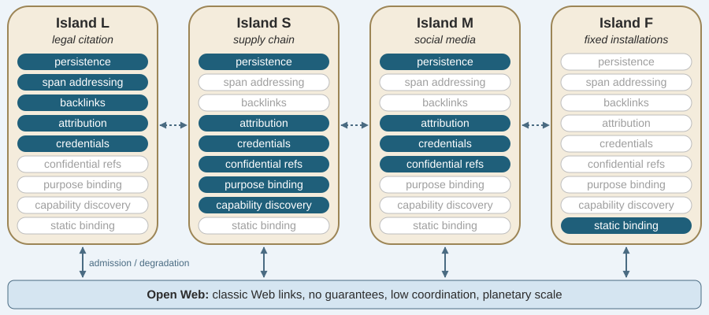

# Part B1 — Full Draft

**Project acronym (working):** ISLANDS
**Project title (working):** A New Web: Bridging NFPs for Heterogeneous
Societal Requirements <!-- was: ...Heterogeneous Requirements -->
**Descriptive subtitle (retained):** Bounded Information Spaces with
Chosen Guarantees — Rebalancing the Web/Xanadu Trade-off for High-Stakes
Information
**PI:** Prof. Dr. Simon Mayer
**Host institution:** University of St. Gallen (USG)
**Duration:** 60 months, indicative start **1 May 2028** (grant
agreement signature scheduled for 8 April 2028; M1 = May 2028, M60 =
April 2033) · **Requested budget:** **[TODO: pending the budget
decision in the Resources and Time Commitment section]** (CoG max €2.0M
plus up to €1.0M additional)
**Primary panel:** PE6 (Computer Science and Informatics)
**Cross-panel relevance:** SH2 (institutions, governance, law)

> Drafting rules honored throughout: B1 is evaluated alone at Step 1 —
> no cross-references to B2, no feasibility detail (feasibility is
> Step 2 only); the synopsis presents idea, state of knowledge,
> objectives, and overall research strategy. B2 = Part II of the
> Scientific Proposal (**7 pages**: implementation & methodology incl.
> feasibility, risk assessment, mitigation) + ongoing-grants annex;
> the separate Resources and Time Commitment section (≤2 pages,
> `draft/resources-and-time-commitment.md`) carries the budget; host support letter and PhD certificate (+
> defense-date evidence if needed) accompany. Guiding maxim from the
> ERC info sessions (`sources/`): *impress non-experts in B1, convince
> experts in B2* — write b.1–b.6 for generalists, mirror the Work
> Programme's own evaluation vocabulary, and lead with the ambition of
> the idea. Page budgets are marked per section. Items I could not
> know are marked **[TODO]**.

---

## Section a — Abstract and cross-panel explanation (max 1 page)

### Abstract (target ≤ 2,000 characters)

<!-- was (before PI edit in B1.docx and closing statement, 2026-10-29):
The Web scaled by giving up stable references, versioning, and
bidirectional links. This trade-off now fails where information
carries consequences: more than half the URLs UK ministers gave
Parliament from 1997 to 2006 had stopped resolving by 2007; a
fabricated audio clip of a party leader circulated, unverifiable,
during Slovakia's 2023 pre-election silence; courts in Europe and
beyond have seen over 1,200 filings with AI-fabricated citations that
no architecture could check; and copyright litigation from Munich to
New York reconstructs attribution trails the Web never recorded. The
coordination cost the Web avoided was deferred, and society now pays
it one incident at a time.

ISLANDS builds a new Web organized around *non-functional properties*
(NFPs). We introduce *islands*: bounded information spaces whose
members choose the NFPs their stakes demand and provide them jointly,
while islands interoperate with each other and with the open Web
through the Web's existing low-coordination mechanisms. Within an
island, we restore the NFPs Xanadu specified (immutable versions,
span-level addresses, traceable transclusion) and add two that
neither architecture anticipated: confidentiality-preserving
references, resolved through secure multi-party computation, that let
members verify a value derived from data they may not read; and
capability discovery that shows autonomous agents which actions are
currently valid. The scientific core is a *theory of chosen
guarantees*, which predicts which NFP bundles an island of a given
size, stake, and threat model can hold, at what coordination cost,
and for which stakeholders. We embody the theory in a reference
architecture and validate it in legal citation and in
cross-organizational supply-chain data, two domains in which our team
runs systems today.
-->

<!-- was (Claude version, 2026-10-29, before PI rewrite in B1.docx):
The World Wide Web scaled to billions of users because its
architecture gave up stable references, versioning, and bidirectional
links. The downsides of this trade-off show wherever information has
consequences: a fabricated audio clip of a party leader circulated,
unverifiable, during Slovakia’s 2023 pre-election silence; over half
the URLs UK ministers gave Parliament in 1997–2006 no longer resolved
by 2007; courts in Europe and beyond have received over 1,200 filings
with AI-fabricated citations; and copyright courts in Munich and New
York must reconstruct attribution trails the Web never recorded. The
Web’s architecture deferred the cost of coordination, and society now
pays it.

ISLANDS extends today’s Web with an architecture organized around
*non-functional properties* (NFPs). *Islands* are bounded information
spaces whose members choose the NFPs their context demands and provide
them jointly, while islands interoperate with each other and the open
Web through its existing low-coordination mechanisms. Within an
island, NFPs such as persistence, precise citation, and attribution
are restored through immutable versions, span-level addresses, and
traceable transclusion. We add two new NFPs: confidentiality-
preserving references, resolved through secure multi-party
computation, that let members verify a value derived from data they
may not read; and capability discovery that shows autonomous agents
which actions are valid. The scientific core is a *theory of chosen
guarantees* that predicts which NFP bundles an island of a given size,
stake, and threat model can hold, at what coordination cost, and for
whom. We embody the theory in a reference architecture and validate it
in legal citation and cross-organizational supply-chain data, where
our team runs systems today. Our theory and open reference
architecture will give society a Web whose guarantees are chosen by
the communities that depend on them, and on which courts, parliaments,
and markets can rely.
-->

The World Wide Web scaled to billions of users because of
architectural decisions that gave up stable references, versioning,
and bidirectional links. The downsides of this trade-off show today,
when information conveyance has societal consequences: a fabricated
audio clip of a party leader circulated, unverifiable, during
Slovakia’s 2023 pre-election silence; over half the URLs UK ministers
gave Parliament in 1997–2006 no longer resolved by 2007; courts in
Europe and beyond have received over 1,200 filings with AI-fabricated
citations; and copyright courts in Munich and New York must
reconstruct attribution trails the Web never recorded. The Web’s
architecture deferred, rather than avoided, the cost of coordination,
and society now pays it.

ISLANDS extends today’s Web with an architecture organized around
*non-functional properties* (NFPs). *Islands* are bounded networked
information spaces whose members choose the NFPs their context demands
and provide them jointly. Within an island, NFPs such as
*persistence*, *confidentiality-preserving references*, and
*attribution* are restored through *immutable versions*, 
*secure-multi-party-computation-based resolution*, and *traceable
transclusion*. Across islands, we establish interoperability through
the open Web's existing low-coordination high-scalability mechanisms,
thereby also guaranteeing backwards-compatibility with today’s World
Wide Web. The scientific core of ISLANDS is a *theory of chosen
guarantees* that predicts which NFP bundles an island of a given size,
stake, and threat model can hold at what coordination cost. We develop
this theory, embody it in a reference architecture, and validate it in
legal citation, cross-organizational supply-chain, and online social
media use cases, where our team has most experience. Our theory and
open reference architecture will give society an extended Web whose
guarantees are chosen by individual user communities that require
them, and on which courts, parliaments, and markets can rely.

### Cross-panel / interdisciplinary explanation

The proposal is computer-systems research and is submitted to **PE6
(Computer Science and Informatics)**. It spans four PE6 descriptors:
PE6_10 (Web and information systems) as its core, PE6_2 (distributed
systems), PE6_5 (cryptology, security, privacy; the SMPC reference
resolution of O3), and PE6_7 (artificial intelligence, intelligent
systems, multi-agent systems; the agent affordance layer of O4). We
expect the scientific contribution to lie in the composition, which
none of these sub-fields produces by itself.<!-- was: none of these sub-fields has produced alone. (PI edit in B1.docx) -->

Two validation domains and one objective also engage legal and
governance scholarship (**SH2**, descriptor SH2_4, legal studies): we
design the legal-citation island with legal practice and the
social-media island against the data-access and transparency duties of
the Digital Services Act, and the stakeholder/incentive analysis (O5) builds on<!-- was: One validation domain and one objective also engage legal and
governance scholarship (**SH2**, descriptor SH2_4, legal studies): we
design the legal-citation island with legal practice and evaluate it
against it, and the stakeholder/incentive analysis (O5) builds on -->
legal scholarship on architecture as regulation, on RFC 9518's
centralization analysis, and on the PI's published work on DSA
auditing and transparency regulation. SH2 expertise would sharpen the
assessment of O5; the methods and deliverables are PE6, and SH2 is
flagged as secondary.

---

## Section b — Extended synopsis (max 5 pages)

### b.1 The problem and the idea (~1.5 pages)

<!-- was: b.1 paragraphs 1-4 before the PI rewrite in B1.docx, 2026-10-29; full text in draft/archive/B1-b1-before-PI-edit-2026-10-29.md -->

The World Wide Web's original design favored simplicity,
decentralization, and low coordination overhead, which enabled
explosive adoption but sacrificed stable references, built-in
versioning, and native bidirectional linking. This was a deliberate
choice: Berners-Lee's 1989 proposal required that the system "allow
existing systems to be linked together without requiring any central
control or coordination" [1], and Fielding and Taylor later clarified
the trade-offs that the resulting architecture yields when defining
the Representational State Transfer (REST) architectural style:
scalable component interactions, uniform interfaces, independently
deployable components, and intermediaries that can be inserted
anywhere [2]. These priorities suited early document-sharing systems
and enabled the Web’s scaling up to billions of users and devices
within three decades. We argue that the Web’s trade-offs are however
too rigid for today’s use cases, where publishers require traceable
dereferencing, supply chain management requires aggregation over
confidential data, courts and parliaments require stable, specific,
citations, users require sovereignty over their data, and society
requires trusted content and accountable authorship.

Over the past twenty years, we have kept the Web’s architecture
fundamentally static and such properties lacking; however, platforms
have responded: Accounts, persistent storage, search, reputation,
payment, and a consistent shared state do not exist between
independent Web sites; platforms provide them inside proprietary
stores into which they draw the Web's content, users, and interactions
[3, 4, 5], and they extend into the rest of the Web through APIs and
plug-ins on their own terms [6]. Users then rebuild continuity
themselves through reposts, screenshots, and off-platform link hubs
[7], yielding unsatisfactory mitigation. Berners-Lee warned in 2010
that social networks were walling off the information their users
posted [8], and RFC 9518 describes the general mechanism: functions
built on open protocols still centralize through network effects and
switching costs [9]. The consequences reach the public sphere:
Engagement-optimized ranking amplifies some political content over
other content [10], and the EU's Digital Services Act now obliges the
largest platforms to assess such systemic risks and to open their data
to vetted researchers [11], an obligation that remains hard to operationalize
because researchers must specify data whose existence they cannot
observe [12].<!-- was: [11], which has been shown to be defunct in principle [x]. --> The Commission's first fine under the Act, €120 million
against X in December 2025, concerned a "verified" badge that anyone
could buy without an identity check and terms that barred researchers
from public data [13]. The Web itself authenticates domains through
TLS certificates, but it offers no native way to state verifiably who
stands behind a document or an account, or what qualifies them [14].
Even the data that platforms do release differs from what their users
see [15, 16]. Press publishers face the same opacity: in October 2026,
the Paris Court of Appeal upheld an order that Meta negotiate
neighbouring-rights payments with French media in good faith, finding
that Meta had supplied only fragmentary, opaque, and unverifiable data
on its use of their content [17]. Legal scholarship treats such architectural choices as
regulation in their own right [18, 19, 20]. And, currently, generative
AI repeats the pattern: answer engines and agentic browsers return
answers in place of links and so control access to the Web's content
[21].<!-- was: [21], and the Court of Justice of the EU must now decide whether a
chatbot's summaries of press articles infringe the publisher's rights
[removed: n21]. (C-250/25 Like Company dropped 2026-10-30 for the decided Paris Meta case) --> The properties that high-stakes communities need are thus
available today, but each inside one platform and under its control.

Society pays for these omissions: In 2007 the UK government found that
more than half of the roughly 4,000 URLs ministers had given in
answers to Parliamentary Questions since 1997 no longer resolved, and
built a redirect service into its national Web archive in response
[22]; one in five scholarly articles cites Web content that has since
rotted [23]. Two days before Slovakia's 2023 election, a fabricated
recording of a party leader discussing vote-rigging circulated with no
provenance that voters could check [24]. From February 2027, batteries
sold in the EU (and, soon after, products from clothes to detergents)
must carry a digital passport with carbon-footprint and due-diligence
data assembled from suppliers along the chain [25]. Law shows the cost
most sharply, because there a reference's stability is part of the
claim it supports. The EU has given judgments and legislation
persistent identifiers through ELI [26, 27], but these name documents,
not cited passages or versions; half the URLs cited in U.S. Supreme
Court opinions no longer resolve, and Perma.cc archives cited pages
one citation at a time [28]. By early 2026, more than 1,200 court
decisions worldwide concerned AI-fabricated citations [29], and the
High Court of England and Wales warned that citing fabricated
authorities may lead to referral to the regulator or to contempt
proceedings [30]. Content provenance is being moved into camera
hardware [31] and into EU law [32, 11], and the Munich Regional Court
held in November 2025 that a language model's memorization of song
lyrics infringes copyright [33], a similar question to what *The New
York Times v. OpenAI* is litigating in the U.S. [34, 35]. What these
cases have in common is that, in each case, coordination cost that the
Web avoided was deferred, not eliminated; and society now pays it one
incident at a time.

**The idea.** We propose to extend the Web’s architecture to build
selected properties into the Web itself, in a way that permits
communities that require them to select their own property
configuration, i.e., a set of desired *non-functional properties*
(NFPs). ISLANDS introduces the *island* to capture such configured
spaces: *Islands* are bounded networked information spaces, such as a
legal-citation community, a supply chain, or a community of
public-interest publishers on social media, whose members share stakes
high enough to justify the cost of coordination through an ex-ante
selected architectural trade-off rather than ex-post patching or
litigation. Each island selects the NFPs its stakes demand and
provides them jointly within its scope, while islands interoperate
with one another and with the open Web through the Web's existing
low-coordination mechanisms that permit planetary scaling. Within an
island, references can for instance be defined as span-level,
version-pinned, bidirectional, and verifiable, similar to how Xanadu
specified them [36, 37]; across the boundary, they degrade to ordinary
Web links, so that every island remains backwards-compatible with
today's Web. Islands can also move away from the Web in the opposite
direction: an island of fixed, high-speed installations may bind its
interfaces once, at design time, in a binary encoding, much as a
linker resolves a program's symbols when it builds the program [37,
38]. Entering an island is an explicit admission step: a client, human
or agent, is shown the island's NFP set and accepts the obligations of
membership, and this is where the island applies its attribution
regime. Through ISLANDS, we further explore NFPs that have not yet
been proposed on an architectural level. These include
*c**onfidentiality-preserving references* that resolve to a value that
members can verify was correctly derived from data they may not read;
this generalizes secure multi-party computation (SMPC), which has run
in production since 2008 [38, 39]. They also include *p**urpose
binding* which attaches the terms of a disclosure (recipient, purpose,
validity window) to the reference, so that a reference is re-resolved
when its terms expire [40]. *Attribution* binds a reference to an
accountable author or, through anonymous credentials and the
pseudonyms the European Digital Identity Wallet must support, to an
eligible but unidentified one [41, 42, 43]. *Verifiable credentials*
let a reference carry an issuer's attested claim about its source,
e.g., that a filing was signed by a member of the bar or that an
emissions figure was checked by an accredited verifier [14, 44].
*Capability discovery* shows agents, after each interaction, only the
actions currently valid, in the hypermedia style of REST [45] as
extended to multi-agent systems [46, 47, 48]; current LLM agents
instead receive statically linked tool catalogues [49, 50]. The
unifying scientific contribution is a **theory of chosen guarantees**:
a formal account of which NFP bundles an island can provide, at which
coordination cost, under which threat model, and for which
stakeholders. Neither hypertext research nor Web engineering offers
this today (b.2).

<!-- was: ASCII architecture schematic (guarantee stack O1-O4 over a content-addressed substrate) and its caption; replaced 2026-10-30 at PI request, full text in draft/archive/B1-b1-before-PI-edit-2026-10-29.md -->
Figure 1 shows islands with different NFP selections, connected to
each other and to the open Web. The theory (O1) predicts which
selection an island of a given size, stake, and threat model can
sustain.

*Figure 1. Four islands with different NFP selections (filled:
selected). Islands L, S, and M are the validation islands of O5; the
fixed installation binds its interfaces at design time (Static Links).
Dashed arrows are references between islands; solid arrows are the
border crossing, i.e., admission inbound and degradation to Classic
Jumplinks outbound. The open Web gives no guarantees and connects all
islands at low coordination cost.*<!-- Figure generated by tools/b1-docx/fig1.py (SVG + PNG fallback via inkscape). -->

### b.2 State of knowledge and the gap (~0.75 page)

Hypertext research assumed rich, versioned, span-anchored links from
the start [36, 51, 52], and its agenda included versioning and
computed structure [53]. Open-hypermedia systems implemented
bidirectional links and referential integrity at workgroup scale
[54, 55]; link rot had hence been addressed before the Web made it
endemic. The Web dropped these guarantees in order to scale
[1, 45]. Remedial infrastructure (e.g., persistent identifiers,
Web archives, Memento [56], Perma.cc [28], and robust hyperlinks
[57]) keeps the mutable substrate and builds compensating archives
beside it. It thereby neither prevents drift nor verifies integrity,
and it reintroduces central coordination points. W3C specifications
address passages and backlinks on the open Web: Web Annotation
selectors [58] and text fragments [59] identify a passage
of a page, and Webmention [60] and Linked Data Notifications
[61], which the W3C Social Web Working Group maintains together with
ActivityPub [62], deliver opt-in backlinks. None of them pins
a version or verifies what it points to. Services assemble
bespoke NFP profiles in the same way, e.g., persistence via Perma.cc,
provenance via C2PA [31], and identity and notarization via DOIs or
blockchains. We read these profiles as evidence of demand for chosen
guarantees, but each serves one silo and none can be shared or
composed. Content-addressed and versioned storage (Git; IPFS [63];
Software Heritage identifiers [64]) and provenance attestation
[31, 65] supply the substrate that Xanadu lacked. They are,
however, storage and signing primitives without span semantics, a
link layer, or a governance model. Nanopublications come closest
[66, 67]. They form a deployed, federated network of immutable,
signed semantic statements with self-verifying identifiers, i.e., an
island at statement granularity, and may become a component of ours;
they do not, however, offer span addressing over arbitrary content,
transclusion, or confidentiality-preserving resolution.

Re-decentralization efforts relocate *control* and leave
*addressability* as it was. Solid's pods keep location-addressed,
mutable resources [68], and data spaces relocate contracts and
governance [69]. Federated social media follows the same line:
ActivityPub distributes servers but keeps posts location-addressed and
mutable [62], and Bluesky's AT Protocol signs and
content-addresses each user's repository [70] but leaves
references between posts unverified and offers one fixed set of
guarantees to all communities. EU data law follows the same line: the Data Act and
the portability rights of the GDPR and the DMA move copies of data
between holders [71], and the Solid deployments that implement them
(cf. our own [72, 73]) leave references location-addressed.
Verborgh argues that raw-data transfer cannot sustain a market and
proposes trading purpose-bound derivations whose terms limit their
shelf life and use [40]. No reference layer can yet name such a
derivation, pin it to a version, or carry its terms. Usage control
formalized such terms [74, 75], and sticky policies bind them to
the data [76]. Enforcement after release, however, requires a
trusted monitor at the recipient or falls back on detection after the
fact [75]. RFC 9518 explains why open specifications alone do not
prevent centralization, and we adopt the design-level mitigations it
lists [9]. Network architecture faced the same question one layer
below. Clark et al. argued that an Internet embedded in society must
leave room for the *tussle* between stakeholders with conflicting
interests, and proposed design for change and controlled transparency
as its tenets [77, 78]. Plutarch argued for heterogeneous
network contexts joined by translating functions at their borders
[79]. These positions state principles but predict no outcome,
and they concern packets and addresses, not references.

SMPC has run in production since the Danish sugar-beet auction of
2008 [38] and in Estonian government statistics [39], and
general-purpose protocols and implementations such as SPDZ [80] and
MP-SPDZ [81] make arbitrary computations practical. Our PEP-LCA
protocol computes joint supply-chain assessments across up to 50,000
participants without a trusted third party [82], and a follow-on
system anchors share disclosure in Solid's access-control layer
[83]. Each of these deployments is, however, a bespoke application,
and none exposes its result as a reference that others can cite and
re-resolve. Information-flow control approached the problem from
programming languages. The decentralized label model [84] and
Fabric [85] let mutually distrusting principals share persistent
objects under confidentiality and integrity labels. They enforce these
labels by placing cleartext only on trusted nodes, over mutable,
store-identified objects, and they do not quantify what sustaining<!-- was: they do not price what sustaining --> a
policy costs. Verifiable credentials address a further part of the
problem: the W3C data model [14], selective-disclosure formats such
as SD-JWT [86], and the European Digital Identity Wallet [43] let
a holder prove an issuer's claim (e.g., a professional licence)
without revealing more than needed [44, 87]. They are,
however, presented to one verifier within one session, and they are
not bound to the references that the claim concerns. Hypermedia multi-agent systems research argues for
run-time affordance discovery [46, 88]. Current LLM-agent
practice, in contrast, uses statically linked tool lists
[49, 50], which<!-- was: uses static tool lists [49, 50], which -->
indirect prompt injection turns into an attack surface [89], and no
existing design connects capability discovery to a verifiable
reference layer.

**The gap.** We are not aware of any system that composes
immutability, span-level verifiable addressing, transclusion,
confidentiality-preserving resolution, and agent-facing affordance
discovery into one reference architecture. We are also not aware of
a theory that predicts which of these guarantees an island of a given size, stake, and threat model can sustain.<!-- was: an island of a given size, stake, and threat model can afford. -->

### b.3 Objectives (~0.5 page)

The goal of ISLANDS is to find out which guarantees a Web
architecture can provide to the communities that need them, and at
what cost, and to demonstrate these guarantees in practice. This
involves:

- **O1 — Theory of chosen guarantees.** We develop a formal model
  that relates guarantee bundles (persistence, span addressing,
  bidirectionality, integrity, confidentiality, attribution, trust,
  usage, discoverability) to coordination *and economic* costs, island
  size, threat models, and stakeholder incentives. We instantiate the
  model as a taxonomy of named **link classes**: a persistence and
  integrity ladder (Classic Jumplinks, Archived, Trusted, Verified,
  and Cryptographic Links, in increasing strength) with five
  cross-cutting axes (attribution, trust, usage, modality, link
  time).<!-- was: with four
  cross-cutting axes (attribution, trust, usage, modality). --> For each
  class, we prove what it minimally requires, and we derive decision
  procedures that an island designer can apply.
- **O2 — Reference layer.** We build an addressing and transclusion
  layer over content-addressed storage. It provides span-level,
  version-pinned, bidirectional, verifiable references, typed by link
  class and able to carry purpose-binding terms, and it interoperates
  with the open Web at island boundaries.
- **O3 — Confidential references.** We turn SMPC-based resolution,
  which verifies a value without disclosing its inputs, from a bespoke
  application protocol [82] into a first-class addressing primitive.
  Each island states its threat model explicitly, from
  honest-but-curious to malicious-secure.
- **O4 — Agent affordance layer.** We build a capability-exposure
  layer through which autonomous agents discover the valid next
  actions in the current state, with link-relation semantics [90]
  and explicit ordering guarantees for state-changing actions.
- **O5 — Validation islands and incentives.** We instantiate and
  evaluate islands in three high-stakes domains: legal citation,
  cross-organizational supply-chain data, and social media.<!-- was: evaluate islands in two high-stakes domains, legal citation and
  cross-organizational supply-chain data. --> For each class of actor, we
  analyze whether islands change the incentive to centralize [9].

### b.4 Research strategy and methods (~1.75 pages)

To achieve these objectives, we propose a theory work package (WP1)
that three systems work packages (WP2–WP4) instantiate and a
validation work package (WP5) tests.

**WP1 — Foundations: the theory of chosen guarantees (M1–M60,
continuous).** Method: formal modeling and design-science iteration.
We develop a guarantee calculus, i.e., a lattice of guarantee bundles
ordered by strength. We formalize the bundles as labels in the
information-flow control tradition [84, 91] and extend these
labels with persistence and attribution components. Each bundle
carries its minimal coordination requirements (e.g., registration,
replication, identity, availability coupling) and its admissible
threat models. Here we draw on distributed-systems impossibility
results [92, 93], simulation-based security definitions [94],
and RFC 9518's centralization vocabulary [9]. Some guarantees cannot
be enforced once a reference has resolved, but compliance with them can be made incentive-compatible. The calculus hence also scores each bundle by the margin by which compliance is less costly than defection for the actor able to defect.<!-- was: but they can be priced. The calculus hence also scores each bundle by the margin by which the compliant path undercuts defection for the actor able to defect. --> This
is the mechanism that transcopyright used for reuse [95] and that
current data-economy proposals use for derived insights [40].

To make the calculus checkable, we name each bundle as a *link class*
that a reference can declare and a client can enforce, much as link
relations [90] or HTTP status codes do at lower stakes. The core is
a ladder of persistence and integrity. **Classic Jumplinks** are the
Web default (location-addressed, no guarantee) and the fallback
outside any island. **Archived Links** stay resolvable through
redundancy, as with Memento and Perma.cc [28, 56], but are not
verified. **Trusted Links** are registered in the island and tracked
bidirectionally, which makes them accountable but not
cryptographically checked [55]. **Verified Links** are span-level,
version-pinned, and content-addressed, so that resolution matches the
cited bytes exactly or fails visibly. **Cryptographic Links** are
resolved through SMPC or zero-knowledge proofs (O3) and return a
verified derivation from data the client never sees. Further axes cut
across the ladder. *Attribution* is non-monotone, since binding
actions to identities trades accountability against chilling effects
[96, 97]; European courts have weighed this balance since the
census judgment [98] and for anonymous online comment [99].
Attribution is hence a pair (Attributed versus Anonymous/Pseudonymous
Links [42]), which we evaluate against island governance<!-- was: which we price against island governance --> as well as
coordination cost. *Trust* adds Endorsed Links, whose resolution
carries a decay-bounded, Sybil-resistant [100] score over retractable
endorsements, and **Credentialed Links**, whose resolution returns a
verifiable credential about the source together with its current
revocation status [14]. Endorsements aggregate the judgment of
peers; credentials rest on the authority of an issuer, and the island
decides which issuers it accepts. *Usage* adds Purpose-Bound Links, whose terms
(recipient, purpose, window) travel with the reference, so that an
expired derivation is re-resolved instead of reused. Since no
substrate can prevent retention [75], we assess this class by its compliance margin<!-- was: we price this class economically -->. *Modality* adds Capability Links (O4's state-dependent
affordances), to which every rung applies as it does to content.
*Link time* records when a reference is resolved, in the sense of
program linkers [101]. Capability Links bind as late as
possible, at each interaction. **Static Links** bind at design time,
in a fixed binary encoding, as Web of Things descriptions already
allow for protocols such as Modbus [102]. They give up the
evolvability that a uniform interface provides and regain the efficiency it sacrifices<!-- was: evolvability that a uniform interface buys and regain the efficiency it costs --> [45], which suits fixed, high-speed installations. Like
attribution, link time is non-monotone: the calculus assesses it by when the coordination cost is incurred, once at design time or incrementally at every interaction<!-- was: the calculus prices it by when coordination is paid, once at design time or a little at every interaction -->.

A declared class is a falsifiable claim with two proof obligations.
*Realizability* requires that, under its coordination requirements
and threat model, a conforming implementation returns the class's
guarantee or fails visibly, and never downgrades silently. *Necessity*
requires that dropping any one requirement admits an execution that
violates the guarantee undetected, i.e., that no rung can be attained at lower coordination cost<!-- was: no rung can be had more cheaply -->. For an island of given size, stake, and threat model, the
calculus then predicts the highest class it can sustain and at what
cost. We develop the calculus iteratively against the WP2–WP4 designs
and test it against WP5 measurements: every architectural choice in
the systems work packages should be derivable from the theory or
force a revision of it. Deliverables are the formal model, the
link-class taxonomy, design decision procedures, and a published
island design handbook.

**WP2 — The reference layer (M1–M42).** Method: systems research with
a reference implementation. We design the island addressing model.
Span-level identifiers are pinned to immutable versions in a
Merkle-DAG store, which we build on Git and IPFS primitives [63] and
on SWHIDs [64], following RFC 9518's advice to reuse proven
mechanisms [9]. A bidirectional link registry scoped to the island
makes explicit the coordination that Xanadu wanted globally and the
Web refused [36], and transclusion records its provenance [65].
Every reference is typed by its WP1 link class, and the type is
enforced structurally. Resolving a Verified or Cryptographic Link
thereby returns the exact cited span (or a verified derivation of it)
or fails visibly. The registry stores retraction as a superseding
record and deletes nothing. A Verified or Trusted Link can hence honour
a legal erasure request [103] without breaking the immutable history
on which other references depend. Boundary design runs in both
directions. Outbound, references degrade gracefully at the island
edge: a Verified or Cryptographic Link becomes a Classic Jumplink for
a non-member client, carrying a text fragment [59] that keeps
the cited passage addressable where the page still contains it, and
interoperates with Memento [56] and robust hyperlinks [57].<!-- was: a non-member client and interoperates with Memento [56] and robust
hyperlinks [57]. --> Inbound, an *admission protocol* (the border
crossing) lets a client discover the island's NFP set and bind to it.
This is where the island applies its attribution regime (e.g., by
asking the client to present verifiable credentials, with selective
disclosure [86], or by issuing one), and where the<!-- was: This is where the island applies its attribution regime (e.g., by
issuing a credential or asking for verified identity), and where the -->
guarantee bundle becomes enforceable on the client as well as on
stored content. We benchmark the reference implementation per link
class for resolution latency, storage overhead, and link-maintenance
cost at island scales of 10² to 10⁵ members, and we publish all
artifacts.

**WP3 — Confidential and verifiable references (M6–M54).** Method:
cryptographic protocol design with proofs and empirical benchmarks. We
generalize the PEP-LCA results [82, 83] into a *resolution
protocol family*. In this family, a reference's target is
secret-shared across island members, and its resolution is a joint
computation with a verifiable result. Research arcs: (i) from
honest-but-curious to malicious security, using verifiable secret
sharing [104] and zero-knowledge correctness proofs, which we expect
to yield a quantified privacy-performance frontier; (ii) protocols
that tolerate member downtime, which removes the availability coupling
we documented in PEP-LCA [82]; and (iii) input integrity through
committed inputs and attested sources that connect to hardware-rooted
provenance [31]. We prove security in the simulation-based model
[94] and evaluate performance on realistic island topologies,
together with K. Mitrokotsa and N. Cheng, who co-supervised the
PEP-LCA work [82].

**WP4 — Agents as hypermedia clients (M12–M54).** Method: design and
comparative evaluation. We build the island's agent gateway, which
exposes capabilities as state-dependent affordances made perceivable
through signifiers [105]. The gateway is a hypermedia-driven layer
[45] over MCP-class agent protocols [49]. It explains *why* an
action is currently valid and gives explicit ordering guarantees for
dependent state-changing calls. Each affordance carries the WP1 link
class of the resource it exposes, so that an agent can tell a Verified
citation from a Classic Jumplink before acting on it. The gateway is
also the border crossing for agent clients. An agent's first
affordance is the acceptance of the island's NFP set, together with a
verifiable credential that states on whose behalf the agent acts, and
identity and obligations hence bind before any state-changing call.<!-- was: affordance is the acceptance of the island's NFP set, and identity and
obligations hence bind before any state-changing call. --> WP4 extends our
work on signifiers [47, 48, 88] towards standardization in the
W3C Autonomous Agents on the Web Community Group.<!-- was: W3C Web Agents Community Group. --> We compare task success, safety
violations, evolvability, and latency under (a) statically linked
tool catalogues, (b) our affordance layer, (c) hybrids, and (d) Static
Links over binary protocol bindings, in scenarios drawn from WP5 and
from fixed installations in building automation (Siemens) and edge
computing (AFarEdge). We expect affordance-scoped exposure to
outperform statically linked catalogues on safety and evolvability
without loss of task success, and Static Links to outperform both on
latency where the installation does not change. The measurements
thereby locate, for each scenario, the link time the calculus should
recommend.<!-- was: violations, and evolvability under (a) static tool catalogues, (b) our
affordance layer, and (c) hybrids, in scenarios drawn from WP5. We
expect affordance-scoped exposure to outperform static catalogues on
safety and evolvability without loss of task success. -->

**WP5 — Validation islands and stakeholder incentives (M12–M60).**
Method: three case studies and a mixed-methods incentive
analysis.<!-- was: Method: two full-depth case studies and a mixed-methods incentive
analysis. --> *Island L (legal citation)* is an
end-to-end pilot in which the citations in a working corpus (e.g., a
law journal's editorial pipeline or a moot-court record) become
span-level, version-pinned, and verifiable, anchored to ECLI and ELI
identifiers where these exist [26, 27]. We measure the
citation-integrity failures made structurally impossible, the
editorial cost compared to Perma-style manual archiving [28], and
practitioner acceptance. Island L also instantiates the *attribution*
NFP. It weighs verified authorship, which makes fabrication
sanctionable, against pseudonymous regimes, which may shield sensitive
filings. Our legal partner is Prof. Tamò-Larrieux (Lausanne), whose
group's doctoral work on chilling effects grounds the anonymity side,
and Island L docks onto the PI's running law/technology projects
(SNSF CoCoDa; *Access to Justice*). *Island S (supply chain)* extends
the running PEP-LCA deployment [82, 83] into a full island with
confidential references and agent-mediated onboarding, together with
its industrial partners (Empa, Siemens). We test it against the
disclosure duties of the EU battery passport and the Carbon Border
Adjustment Mechanism, which require emissions data from upstream
suppliers, including installations outside the EU [25, 106]. Since
CBAM requires actual emission values to be checked by accredited
verifiers [107], Island S also tests Credentialed Links that
carry the verifier's attestation together with the confidential
value. *Island M (social media)* gathers public-interest publishers
(e.g., public broadcasters, election authorities, and newsrooms) on a
federated network [62]. Their posts become version-pinned
and attributed, edits and deletions become superseding records, and
Credentialed Links state who stands behind an account, which a
purchasable badge does not [13]. Vetted researchers resolve
Cryptographic Links to exposure statistics that instance operators
compute jointly over interaction data that none of them discloses.
Island M thereby tests confidential references against the
researcher data access of the DSA [11] and against the gap between
released and seen data that we documented [15, 16]. We measure the
survival of posts and links compared to platform baselines [7], the
share of research queries answered without raw-data transfer, and
acceptance by publishers and researchers.

The *incentive analysis* studies each class of actor (hyperscaler,
legacy industry, OSS/privacy community, browser vendor, platform,
public record-keeper) through interviews, institutional analysis of
funding models, and the RFC 9518 mitigation checklist [9]. For each
class, it asks whether an island changes the actor's incentive to
centralize. It also asks whether an island can be configured so that
the guarantee-respecting path is the actor's least costly one, since a guarantee that no actor has an incentive to keep<!-- was: the actor's cheapest one, since a guarantee that no actor is paid to keep --> is one the theory should
decline to promise. The analysis thereby delivers the stakeholder half
of O1's decision procedures. It builds on our platform-audit work
[15, 16], our working relationship with Solid's steward (the ODI,
a CoCoDa partner), and the PI's seat on the European VLOP-auditing
oversight board.

**Integration and openness.** Annual integration milestones bind the
WP2–WP4 prototypes into one architecture, which WP5 then evaluates.
All software is open source, and all publications are open access.
All specifications go to the W3C groups that maintain the protocols
islands build on, or to their successors: the Linked Web Storage
Working Group (reference layer), the Social Web Working and Community
Groups (Island M), the Verifiable Credentials and Federated Identity
Working Groups (admission), the Web of Things Working Group (Static
Links), and the Autonomous Agents on the Web Community Group (agent
layer).<!-- was: All software is open source, all specifications go to open fora
(e.g., a W3C Community Group or the IETF, as WP1 informs), and all
publications are open access. -->

### b.5 Team (~0.25 page)

ISLANDS consolidates the PI's research lines in Web architecture,
ubiquitous computing, human-computer interaction, and law. In *Web
architecture*, the Web of Things [108], its W3C standardization
[102] (now deployed in industrial products), and hypermedia
multi-agent systems [46, 47, 88] ground the reference layer
(WP2) and the agent layer (WP4). In *ubiquitous computing*, references
that bind physical artifacts to digital records [109] and
personalization systems that mediate what people perceive in their
surroundings [110] extend islands from documents to devices, places,
and the people in them. In *human-computer interaction*, the PI's work
on affordances and signifiers [48] informs WP4's capability
discovery and the admission step at an island's border, where a
client is shown the obligations it accepts. In *law*, regulation
expressed as technical architecture [20, 111, 112], platform
auditing under the DSA [15, 16], and membership in the European
VLOP-auditing oversight board ground Islands L and M, the attribution
regime, and the incentive analysis (WP5).<!-- was: VLOP-auditing oversight board ground Island L, the attribution regime,
and the incentive analysis (WP5). --> Each line has so far addressed one
part of the problem. The theory of chosen guarantees (O1) needs all of
them, because an island's guarantees are at once architectural,
experienced by people, and legally consequential. The PI stepped down
as Dean in February 2026 to pursue this programme (≥40% commitment).

Two team members carry the running systems on which the project
builds. **Luka Bekavac** (through 2029, ≈M20) brings the empirical and
regulatory instruments (e.g., platform transparency, DSA data-access
auditing, integrity-by-design referencing [15, 16, 109]) for
WP5's legal and social-media islands and the incentive analysis.<!-- was: WP5's legal island and incentive analysis. --> **Jan Grau** (through 2029,
≈M20) built the PEP-LCA SMPC stack and its Solid integration
[82, 83], which anchor WP3's first arc and Island S. We will
recruit an applied-cryptography postdoc (WP3 lead, from M1), two PhD
students (reference layer, WP2, M1; agent layer, WP4, ~M6), a
socio-technical postdoc who succeeds Bekavac with overlap (WP5, from
~M17), a further PhD student on the legal island (from ~M21,
co-supervised with the legal partner), and a research engineer for
the shared prototype. External collaborators are Mitrokotsa and Cheng
(cryptography), Ciortea (hypermedia MAS, USG), Tamò-Larrieux (law,
Lausanne), the ODI and the Solid community (via CoCoDa), and the
industrial WISER partners (Empa, Siemens).

### b.6 Ambition, risk, gain (~0.25 page)

ISLANDS tests the hypotheses that a coordination cost the Web's
designers judged prohibitive [1, 2] is sustainable at island scale<!-- was: is affordable at island scale -->, that cryptographic reference resolution can reach interactive
latency, and that actors with divergent incentives will adopt shared
guarantees. Each hypothesis can be refuted. O1 hence treats guarantees
as *chosen*, and O5 measures incentives alongside latency. If our
hypotheses hold, we will deliver a validated architecture for the
parts of the information space where the Web's founding trade-off now
fails at measurable cost, chiefly the parliamentary, legal, and
scientific record, public discourse on social media, and regulated
industrial data.<!-- was: fails at measurable cost, chiefly the parliamentary, legal, and
scientific record and regulated industrial data. --> Autonomous agents
could then act on verifiable information in these spaces. If our
hypotheses fail, the theory still delimits which guarantees are attainable, for whom<!-- was: which guarantees are affordable, for whom -->, and at what cost.

### References (not counted toward the page limit)

[1] T. Berners-Lee. *Information Management: A Proposal.* CERN, March 1989.
[2] R. T. Fielding, R. N. Taylor. Principled design of the modern Web architecture. *ACM Transactions on Internet Technology* 2(2):115–150, 2002. doi:10.1145/514183.514185
[3] T. Gillespie. The politics of 'platforms'. *New Media & Society* 12(3):347–364, 2010. doi:10.1177/1461444809342738
[4] J.-C. Plantin, C. Lagoze, P. N. Edwards, C. Sandvig. Infrastructure studies meet platform studies in the age of Google and Facebook. *New Media & Society* 20(1):293–310, 2018. doi:10.1177/1461444816661553
[5] J. van Dijck, T. Poell, M. de Waal. *The Platform Society: Public Values in a Connective World.* Oxford University Press, 2018. doi:10.1093/oso/9780190889760.001.0001
[6] A. Helmond. The platformization of the Web: Making Web data platform ready. *Social Media + Society* 1(2), 2015. doi:10.1177/2056305115603080
[7] L. Bekavac, S. Mayer. Broken links and fading stories: How dominant online platforms subvert the hypermedia foundation of the Web. *ACM Web Science Conference (WebSci '26)*, 221–226, 2026. doi:10.1145/3795766.3799767
[8] T. Berners-Lee. Long live the Web. *Scientific American* 303(6):80–85, 2010. doi:10.1038/scientificamerican1210-80
[9] M. Nottingham. *Centralization, Decentralization, and Internet Standards.* RFC 9518, IETF, 2023.
[10] F. Huszár, S. I. Ktena, C. O'Brien, L. Belli, A. Schlaikjer, M. Hardt. Algorithmic amplification of politics on Twitter. *PNAS* 119(1):e2025334119, 2022. doi:10.1073/pnas.2025334119
[11] Regulation (EU) 2022/2065 (Digital Services Act), Arts. 34, 35(1)(k), and 40; Commission Delegated Regulation (EU) 2025/2050 on data access for vetted researchers.
[12] C. Goanta, S. Zannettou, R. Kaushal, J. van de Kerkhof, T. Bertaglia, T. Annabell, H. Gui, G. Spanakis, A. Iamnitchi. The great data standoff: Researchers vs. platforms under the Digital Services Act. *Proceedings of the International AAAI Conference on Web and Social Media (ICWSM)* 20(1):874–888, 2026. doi:10.1609/icwsm.v20i1.42671
[13] European Commission. Commission fines X €120 million under the Digital Services Act. Press release, 5 December 2025.
[14] M. Sporny, T. Thibodeau Jr, I. Herman, G. Cohen, M. B. Jones (eds.). *Verifiable Credentials Data Model v2.0.* W3C Recommendation, 15 May 2025.
[15] L. Bekavac, J. Strecker-Bischoff, K. Garcia, S. Mayer, A. Tamò-Larrieux. Scrutinizing systemic risks in personalized recommender systems through sock-puppet auditing of VLOPs. *ACM Transactions on Recommender Systems* 5(1):1–47, 2026. doi:10.1145/3795516
[16] L. Bekavac, S. Mayer. Platforms' research API data access: What users see vs. what researchers can retrieve. *ACM FAccT* 2026. doi:10.1145/3805689.3812237
[17] Cour d'appel de Paris, rulings of 29 October 2026 upholding the July 2026 order of the Autorité de la concurrence against Meta (neighbouring rights of press publishers); reported by AFP, "French court rules Meta must negotiate over rights payments", France 24, 29 October 2026. **[replace with the decision reference once published]**
[18] L. Lessig. *Code and Other Laws of Cyberspace.* Basic Books, 1999.
[19] M. Hildebrandt. *Smart Technologies and the End(s) of Law.* Edward Elgar, 2015. doi:10.4337/9781849808774
[20] A. Tamò-Larrieux, S. Mayer, Z. Zihlmann. Not hardcoding but softcoding data protection. *Technology and Regulation* 2021:17–34, 2021. doi:10.71265/a1wsy445
[21] L. Zard. Internet ozone layer: A vision for reclaiming human freedom in information civilization. Working paper, SSRN 5735624, 2025.
[22] A. Spencer, J. Sheridan, D. Thomas, D. Pullinger. UK government Web continuity: Persisting access through aligning infrastructures. *International Journal of Digital Curation* 4(1):107–124, 2009. doi:10.2218/ijdc.v4i1.82
[23] M. Klein, H. Van de Sompel, R. Sanderson, H. Shankar, L. Balakireva, K. Zhou, R. Tobin. Scholarly context not found: One in five articles suffers from reference rot. *PLoS ONE* 9(12):e115253, 2014. doi:10.1371/journal.pone.0115253
[24] L. de Nadal, P. Jančárik. Beyond the deepfake hype: AI, democracy, and "the Slovak case". *Harvard Kennedy School Misinformation Review* 5(4), 2024. doi:10.37016/mr-2020-153
[25] Regulation (EU) 2023/1542 (Batteries Regulation), Art. 77 and Annex XIII (battery passport, applicable from 18 February 2027).
[26] Council conclusions inviting the introduction of the European Case Law Identifier (ECLI) and a minimum set of uniform metadata for case law. OJ C 127, 29 April 2011.
[27] Council conclusions inviting the introduction of the European Legislation Identifier (ELI). OJ C 325, 26 October 2012.
[28] J. Zittrain, K. Albert, L. Lessig. Perma: Scoping and addressing the problem of link and reference rot in legal citations. *Legal Information Management* 14(2):88–99, 2014. doi:10.1017/S1472669614000255
[29] D. Charlotin. *AI Hallucination Cases* database, damiencharlotin.com/hallucinations, accessed May 2026. **[re-check counts at submission]**
[30] *R (Ayinde) v. London Borough of Haringey; Al-Haroun v. Qatar National Bank* [2025] EWHC 1383 (Admin), Divisional Court, 6 June 2025.
[31] Coalition for Content Provenance and Authenticity. *C2PA Technical Specification*, v2, 2024–2025.
[32] Regulation (EU) 2024/1689 (Artificial Intelligence Act), Art. 50.
[33] Landgericht München I, judgment of 11 November 2025, 42 O 14139/24 (*GEMA v. OpenAI*), not final. **[re-check appeal status at submission]**
[34] *The New York Times Co. v. Microsoft Corp. and OpenAI*, No. 1:23-cv-11195 (S.D.N.Y., filed 27 December 2023).
[35] George Washington University Law School. *Database of AI Litigation (DAIL)*, accessed 2026. **[re-check at submission]**
[36] T. H. Nelson. *Literary Machines.* Mindful Press, 1981.
[37] T. H. Nelson. Xanalogical structure, needed now more than ever. *ACM Computing Surveys* 31(4es), 1999.
[38] P. Bogetoft, D. L. Christensen, I. Damgård, M. Geisler, T. Jakobsen, M. Krøigaard, et al. Secure multiparty computation goes live. *Financial Cryptography and Data Security 2009*, LNCS 5628:325–343. doi:10.1007/978-3-642-03549-4_20
[39] D. Bogdanov, L. Kamm, B. Kubo, R. Rebane, V. Sokk, R. Talviste. Students and taxes: A privacy-preserving study using secure computation. *Proceedings on Privacy Enhancing Technologies* 2016(3):117–135. doi:10.1515/popets-2016-0019
[40] R. Verborgh. Inside the insight economy. ruben.verborgh.org, 12 August 2025.
[41] D. Chaum. Security without identification: Transaction systems to make big brother obsolete. *Communications of the ACM* 28(10):1030–1044, 1985. doi:10.1145/4372.4373
[42] J. Camenisch, A. Lysyanskaya. An efficient system for non-transferable anonymous credentials with optional anonymity revocation. *EUROCRYPT 2001*, LNCS 2045:93–118. doi:10.1007/3-540-44987-6_7
[43] Regulation (EU) 2024/1183 amending Regulation (EU) No 910/2014 as regards establishing the European Digital Identity Framework.
[44] J. Sedlmeir, R. Smethurst, A. Rieger, G. Fridgen. Digital identities and verifiable credentials. *Business & Information Systems Engineering* 63(5):603–613, 2021. doi:10.1007/s12599-021-00722-y
[45] R. T. Fielding. *Architectural Styles and the Design of Network-based Software Architectures.* PhD thesis, University of California, Irvine, 2000.
[46] A. Ciortea, S. Mayer, F. Gandon, O. Boissier, A. Ricci, A. Zimmermann. A decade in hindsight: The missing bridge between multi-agent systems and the World Wide Web. *AAMAS 2019*, 1659–1663.
[47] D. Vachtsevanou, A. Ciortea, S. Mayer, J. Lemée. Signifiers as a first-class abstraction in hypermedia multi-agent systems. *AAMAS 2023*, 1200–1208.
[48] J. Lemée, D. Vachtsevanou, S. Mayer, A. Ciortea. Signifiers for conveying and exploiting affordances: From human-computer interaction to multi-agent systems. *Annals of Mathematics and Artificial Intelligence* 92(4):815–835, 2024. doi:10.1007/s10472-024-09938-6
[49] *Model Context Protocol Specification*, version 2025-06-18. modelcontextprotocol.io.
[50] T. Schick, J. Dwivedi-Yu, R. Dessì, R. Raileanu, M. Lomeli, E. Hambro, L. Zettlemoyer, N. Cancedda, T. Scialom. Toolformer: Language models can teach themselves to use tools. *NeurIPS 2023*, 68539–68551.
[51] V. Bush. As we may think. *The Atlantic Monthly* 176(1):101–108, 1945.
[52] D. C. Engelbart, W. K. English. A research center for augmenting human intellect. *AFIPS Fall Joint Computer Conference*, 395–410, 1968. doi:10.1145/1476589.1476645
[53] F. G. Halasz. Reflections on NoteCards: Seven issues for the next generation of hypermedia systems. *Communications of the ACM* 31(7):836–852, 1988. doi:10.1145/48511.48514
[54] A. M. Fountain, W. Hall, I. Heath, H. C. Davis. MICROCOSM: An open model for hypermedia with dynamic linking. *ECHT '90*, Cambridge University Press, 298–311, 1990.
[55] H. C. Davis. Referential integrity of links in open hypermedia systems. *ACM Hypertext '98*, 207–216, 1998. doi:10.1145/276627.276650
[56] H. Van de Sompel, M. Nelson, R. Sanderson. *HTTP Framework for Time-Based Access to Resource States: Memento.* RFC 7089, IETF, 2013.
[57] T. A. Phelps, R. Wilensky. Robust intra-document locations. *Computer Networks* 33(1–6):105–118, 2000. doi:10.1016/S1389-1286(00)00043-8
[58] R. Sanderson, P. Ciccarese, B. Young (eds.). *Web Annotation Data Model.* W3C Recommendation, 23 February 2017.
[59] N. Burris, D. Bokan (eds.). *URL Fragment Text Directives.* W3C WICG Draft Community Group Report, 2023.
[60] A. Parecki (ed.). *Webmention.* W3C Recommendation, 12 January 2017.
[61] S. Capadisli, A. Guy (eds.). *Linked Data Notifications.* W3C Recommendation, 2 May 2017.
[62] C. Lemmer-Webber, J. Tallon, E. Shepherd, A. Guy, E. Prodromou. *ActivityPub.* W3C Recommendation, 23 January 2018.
[63] J. Benet. IPFS: Content addressed, versioned, P2P file system. arXiv:1407.3561, 2014.
[64] ISO/IEC 18670:2025. *Information technology: SoftWare Hash IDentifier (SWHID) specification.*
[65] L. Moreau, P. Missier (eds.). *PROV-DM: The PROV Data Model.* W3C Recommendation, 2013.
[66] T. Kuhn, M. Dumontier. Trusty URIs: Verifiable, immutable, and permanent digital artifacts for linked data. *ESWC 2014*, LNCS 8465:395–410. doi:10.1007/978-3-319-07443-6_27
[67] T. Kuhn, C. Chichester, M. Krauthammer, N. Queralt-Rosinach, R. Verborgh, et al. Decentralized provenance-aware publishing with nanopublications. *PeerJ Computer Science* 2:e78, 2016.
[68] A. V. Sambra, E. Mansour, S. Hawke, M. Zereba, N. Greco, A. Ghanem, D. Zagidulin, A. Aboulnaga, T. Berners-Lee. Solid: A platform for decentralized social applications based on linked data. Technical report, MIT CSAIL and QCRI, 2016.
[69] B. Otto, M. ten Hompel, S. Wrobel (eds.). *Designing Data Spaces: The Ecosystem Approach to Competitive Advantage.* Springer, 2022. doi:10.1007/978-3-030-93975-5
[70] M. Kleppmann, P. Frazee, J. Gold, J. Graber, D. Holmgren, D. Ivy, J. Johnson, B. Newbold, J. Volpert. Bluesky and the AT Protocol: Usable decentralized social media. *ACM CoNEXT Workshop on the Decentralization of the Internet (DIN '24)*, 1–7, 2024. doi:10.1145/3694809.3700740
[71] Regulation (EU) 2023/2854 (Data Act); Regulation (EU) 2016/679 (GDPR), Art. 20; Regulation (EU) 2022/1925 (Digital Markets Act), Art. 6(9).
[72] L. Bekavac. From data portability to data control: Making regulation technically real. *4th Solid Symposium*, London, 2026.
[73] L. K. Seiling, J. Stein, S. Mayer, L. Bekavac. A Solid research infrastructure leveraging DMA data portability. 2026. **[TODO: venue]**
[74] J. Park, R. Sandhu. The UCON_ABC usage control model. *ACM Transactions on Information and System Security* 7(1):128–174, 2004. doi:10.1145/984334.984339
[75] A. Pretschner, M. Hilty, D. Basin. Distributed usage control. *Communications of the ACM* 49(9):39–44, 2006. doi:10.1145/1151030.1151053
[76] S. Pearson, M. Casassa-Mont. Sticky policies: An approach for managing privacy across multiple parties. *IEEE Computer* 44(9):60–68, 2011. doi:10.1109/MC.2011.225
[77] D. D. Clark, J. Wroclawski, K. R. Sollins, R. Braden. Tussle in cyberspace: Defining tomorrow's Internet. *IEEE/ACM Transactions on Networking* 13(3):462–475, 2005. doi:10.1109/TNET.2005.850224
[78] D. D. Clark, K. Sollins, J. Wroclawski, T. Faber. Addressing reality: An architectural response to real-world demands on the evolving Internet. *ACM SIGCOMM FDNA '03*, 247–257, 2003. doi:10.1145/944759.944761
[79] J. Crowcroft, S. Hand, R. Mortier, T. Roscoe, A. Warfield. Plutarch: An argument for network pluralism. *ACM SIGCOMM FDNA '03*, 258–266, 2003. doi:10.1145/944759.944763
[80] I. Damgård, V. Pastro, N. Smart, S. Zakarias. Multiparty computation from somewhat homomorphic encryption. *CRYPTO 2012*, LNCS 7417:643–662. doi:10.1007/978-3-642-32009-5_38
[81] M. Keller. MP-SPDZ: A versatile framework for multi-party computation. *ACM CCS 2020*, 1575–1590. doi:10.1145/3372297.3417872
[82] J. Grau. Towards decentralized privacy-enhancing life cycle assessment. MSc thesis, University of St. Gallen, 2025.
[83] J. Grau, M. Maftun, K. Garcia, S. Mayer. Solid and secure multi-party computation for a circular economy. *Solid Symposium* 2026.
[84] A. C. Myers, B. Liskov. A decentralized model for information flow control. *SOSP 1997*, 129–142.
[85] J. Liu, M. D. George, K. Vikram, X. Qi, L. Waye, A. C. Myers. Fabric: A platform for secure distributed computation and storage. *SOSP 2009*, 321–334.
[86] D. Fett, K. Yasuda, B. Campbell. *Selective Disclosure for JSON Web Tokens.* RFC 9901, IETF, 2025.
[87] A. Mühle, A. Grüner, T. Gayvoronskaya, C. Meinel. A survey on essential components of a self-sovereign identity. *Computer Science Review* 30:80–86, 2018. doi:10.1016/j.cosrev.2018.10.002
[88] D. Vachtsevanou, B. de Lima, A. Ciortea, J. F. Hübner, S. Mayer, J. Lemée. Enabling BDI agents to reason on a dynamic action repertoire in hypermedia environments. *AAMAS 2024*, 1856–1864.
[89] K. Greshake, S. Abdelnabi, S. Mishra, C. Endres, T. Holz, M. Fritz. Not what you've signed up for: Compromising real-world LLM-integrated applications with indirect prompt injection. *ACM AISec '23*, 79–90, 2023. doi:10.1145/3605764.3623985
[90] M. Nottingham. *Web Linking.* RFC 8288, IETF, 2017.
[91] D. E. Denning. A lattice model of secure information flow. *Communications of the ACM* 19(5):236–243, 1976.
[92] M. J. Fischer, N. A. Lynch, M. S. Paterson. Impossibility of distributed consensus with one faulty process. *Journal of the ACM* 32(2):374–382, 1985. doi:10.1145/3149.214121
[93] S. Gilbert, N. Lynch. Brewer's conjecture and the feasibility of consistent, available, partition-tolerant web services. *ACM SIGACT News* 33(2):51–59, 2002. doi:10.1145/564585.564601
[94] R. Canetti. Universally composable security: A new paradigm for cryptographic protocols. *FOCS 2001*, 136–145. doi:10.1109/SFCS.2001.959888
[95] T. H. Nelson. Transcopyright: A simple legal arrangement for sharing, re-use, and republication of copyrighted material on the net. *WWCA '97*, LNCS 1274, Springer, 1997.
[96] J. W. Penney. Internet surveillance, regulation, and chilling effects online: A comparative case study. *Internet Policy Review* 6(2), 2017. doi:10.14763/2017.2.692
[97] M. Büchi, E. Fosch-Villaronga, C. Lutz, A. Tamò-Larrieux, S. Velidi, S. Viljoen. The chilling effects of algorithmic profiling: Mapping the issues. *Computer Law & Security Review* 36:105367, 2020. doi:10.1016/j.clsr.2019.105367
[98] Bundesverfassungsgericht, judgment of 15 December 1983, 1 BvR 209/83 (*Volkszählungsurteil*), BVerfGE 65, 1.
[99] European Court of Human Rights (Grand Chamber), *Delfi AS v. Estonia*, no. 64569/09, 16 June 2015.
[100] J. R. Douceur. The Sybil attack. *IPTPS 2002*, LNCS 2429:251–260. doi:10.1007/3-540-45748-8_24
[101] J. R. Levine. *Linkers and Loaders.* Morgan Kaufmann, 2000.
[102] S. Kaebisch, M. McCool, E. Korkan (eds.). *Web of Things (WoT) Thing Description 1.1.* W3C Recommendation, 2023.
[103] Regulation (EU) 2016/679 (General Data Protection Regulation), Art. 17.
[104] T. P. Pedersen. Non-interactive and information-theoretic secure verifiable secret sharing. *CRYPTO '91*, LNCS 576:129–140.
[105] D. A. Norman. *The Design of Everyday Things.* Revised and expanded edition, Basic Books, 2013.
[106] Regulation (EU) 2023/956 (Carbon Border Adjustment Mechanism), Art. 35 and Annex IV.
[107] Regulation (EU) 2023/956 (CBAM), Arts. 8 and 18; Commission Implementing Regulation (EU) 2025/2546 (verification principles); Commission Delegated Regulation (EU) 2025/2551 (accreditation of verifiers).
[108] S. Mayer. *Interacting with the Web of Things.* Doctoral thesis, ETH Zurich, 2014.
[109] L. Bekavac, S. Mayer, J. Strecker. QR-code integrity by design. *Extended Abstracts of CHI 2024*, 1–9. doi:10.1145/3613905.3651006
[110] J. Strecker, S. Mayer, K. Bektaş. Towards societally beneficial personalized realities: A conceptual foundation for responsible ubiquitous personalization systems. *ACM DIS 2025*, 1792–1814. doi:10.1145/3715336.3735709
[111] A. Tamò-Larrieux, C. Guitton, S. Mayer. A computational science perspective on the legal system. *Nature Computational Science* 5(11):990–991, 2025. doi:10.1038/s43588-025-00827-4
[112] C. Guitton, A. Tamò-Larrieux, S. Mayer. *AI and Law: How Automation is Changing the Law.* Routledge, 2025.

---

## Section c — Curriculum vitae and track record (max 4 pages)

> Populated from the PI's October 2025 CV/publication list
> (`sources/EPFL-*`). Trim to 4 pages after template formatting.

### Personal information

Prof. Dr. Simon Mayer; born 16 July 1987; Austrian; three children
(2015, 2017, 2019). ORCID 0000-0001-6367-3454.

**PhD:** Dr.sc. ETH in Computer Science, ETH Zurich; **defense
12 September 2014** (the defense date counts); **eligible** for CoG
2027 under its 5–15-year window (12.3 years on 01.01.2027), no
extensions needed. Further degrees: MAS in Secondary and Higher
Education, ETH Zurich (2014); B.A. in Economics and Business
Administration, University of Zurich (2014); M.Sc. ETH in Computer
Science (2010).

### Current and previous positions

- 2018–today: **Full Professor of Computer Science** (Interaction- and
  Communication-based Systems), University of St. Gallen (USG); one of the
  four founding professors of the School of Computer Science.
- 2024–02/2026: **Dean**, School of Computer Science, University of
  St. Gallen (stepped down to refocus on research, which frees the time for the ERC ≥40% commitment)<!-- was: (stepping down to refocus on research — directly supports
  the ERC ≥40% commitment) -->. 2022–2024 Academic Director; 2018–today
  Director and 2018–2024 Managing Director, Institute of Computer
  Science.
- 2020–today: Board Member, **Research Center for Information Law**, USG.
- 2023: Visiting Professor, University of Bologna. 2018–2020: Senior
  Scientist, Distributed Systems Group, ETH Zurich. 2017–2018: Area
  Manager "Cognitive Products", Pro2Future GmbH & Project Scientist,
  Graz University of Technology. 2014–2017: Research Scientist, then
  Senior Researcher and **Senior Key Expert, Siemens Corporate
  Technology**, Berkeley, USA. 2015–2017: Visiting Lecturer, UC
  Berkeley and ETH Zurich. 2013: Visiting Researcher, Ghent
  University. 2012: Visiting Researcher, MIT.

### Ten most significant research outputs

(Chosen to evidence what ISLANDS needs:<!-- was: (Chosen to evidence the three capabilities ISLANDS needs: --> carrying Web
architecture research into standards and products; law/technology
co-design; and the two running systems the project builds on.)

1. **W3C Web of Things Thing Description standards**: the PI's PhD<!-- was: Thing Description standards** — the PI's PhD -->
   and Siemens-era research contributed to the basis of W3C WoT TDs,
   today deployed in industrial products (e.g., Siemens Desigo
   building management). Evidence for the exact pathway ISLANDS plans
   for its island specifications: research results carried into an
   open standard and from there into practice.
2. Ciortea, **Mayer**, Gandon, Boissier, Ricci, Zimmermann. *A Decade
   in Hindsight: The Missing Bridge Between Multi-Agent Systems and
   the World Wide Web.* AAMAS 2019. (Conceptual foundation of WP4;
   consolidated via two co-organized Dagstuhl seminars, 21072 & 23081,
   and the PI's founding membership of the W3C Web Agents CG.)
3. Vachtsevanou, Ciortea, **Mayer**, Lemée. *Signifiers as a
   First-class Abstraction in Hypermedia Multi-Agent Systems.* AAMAS
   2023; and Vachtsevanou et al., *Enabling BDI Agents to Reason on a
   Dynamic Action Repertoire in Hypermedia Environments.* AAMAS 2024.
   (Run-time affordance exposure; WP4's direct technical basis.)<!-- was: (Run-time affordance exposure — WP4's direct technical basis.) -->
4. Guitton, Tamò-Larrieux, **Mayer**. ***AI and Law: How Automation is
   Changing the Law.*** Routledge, 2025. (Book consolidating seven
   years of the automatically-processable-regulation line; the documented legal-field record<!-- was: regulation line — the
   documented legal-field record --> the motivation leans on.)
5. Tamò-Larrieux, Guitton, **Mayer**. *A Computational Science
   Perspective on the Legal System.* **Nature Computational Science**,
   2025.
6. **Mayer**, Fuchs, Brügger, Lian, Ciortea. *Improving Customer
   Decisions in Web-based E-commerce through Guerrilla Modding.*
   **Nature Machine Intelligence** 3(12), 2021. (User-side
   re-engineering of Web experiences; an early form of the<!-- was: re-engineering of Web experiences — early form of the -->
   islands-vs-platform-defaults argument.)
7. Grau, Maftun, Garcia, **Mayer**. *Solid and Secure Multi-Party
   Computation for a Circular Economy.* Solid Symposium 2026; with
   Grau's MSc thesis (2025, supervised by the PI with Garcia,
   Mitrokotsa, Cheng). (Running system behind WP3/Island S.)
8. Bekavac, **Mayer**. *Platforms' Research API Data Access: What
   Users See vs. What Researchers can Retrieve.* ACM FAccT 2026
   (preprint: arXiv:2601.12390); and Bekavac, Strecker-Bischoff, Garcia, **Mayer**, Tamò-Larrieux. *Scrutinizing Systemic Risks in Personalized Recommender Systems Through Sock-Puppet Auditing of VLOPs.* ACM Transactions on Recommender Systems 5(1), 2026.<!-- was: and Bekavac, Garcia, Strecker,
   **Mayer**, Tamò-Larrieux. *From Walls to Windows.* CEUR-WS 3898,
   2024. --> (Empirical basis of the incentive analysis, WP5.)
9. Tamò-Larrieux, **Mayer**, Zihlmann. *Not Hardcoding but Softcoding
   Data Protection.* Technology and Regulation, 2021; with the
   *Artificial Intelligence and Law* line on automatically processable
   regulation (2022–2025). (Law expressed as architecture: the design stance<!-- was: (Law expressed as architecture — the
   design stance --> ISLANDS generalizes.)
10. Two CHI 2025 **Honorable Mentions** (adaptive industrial robots;
    responsible ubiquitous personalization, DIS 2025) and U.S. Patent
    US11331803B2 (mixed-reality robot programming, with Siemens).
    (Breadth: HCI venues + transfer to IP.)

### Funding record

PI or Co-PI on **4 SNSF, 2 Innosuisse, 3 EU, and 12+
industry/foundation projects** (3.9 MCHF allocated to the PI's group
out of 13.6 MCHF total), including: SNSF **HyperAgents** (2019–2024,
hypermedia MAS; WP4 ancestry)<!-- was: hypermedia MAS — WP4 ancestry) -->; EU **IntellIoT** RIA (2020–2024); EU
**AFarEdge** Chips JU RIA (2026–2029, task leader for the architecture; WP2/WP4 ancestry)<!-- was: task leader for the
architectural framework; WP2/WP4 ancestry) --><!-- was: architectural framework — WP2/WP4 ancestry) -->; Innosuisse Flagship
**WISER** (2022–2026, climate
intelligence/LCA; Island S ancestry)<!-- was: intelligence/LCA — Island S ancestry) -->; SNSF **CoCoDa** (2025–2029,
VLOP regulation, with Lausanne, Maastricht, and the Open Data
Institute; Island L and incentive-analysis ancestry)<!-- was: Institute — Island L and incentive-analysis ancestry) -->; SNSF/Innosuisse
Bridge Discovery **Access to Justice** (2026–2030, with Caritas
Switzerland); TA-SWISS *Sprachmodelle und Kompetenzverschiebungen*
(2025–2026).

### Supervision and team-building

Built a research group and, as founding professor and Dean, a
department (10 research groups, 120+ employees, ~300 students, within
budget). Five postdocs mentored into faculty/senior positions (Gómez, now Assoc. Prof., TU Braunschweig; Garcia, TT Asst. Prof., IT:U Linz; Ciortea, Asst. Prof., USG; Guitton, Swiss Re; Bektaş, Senior Researcher, KSSG)<!-- was: (Gómez →
Assoc. Prof., TU Braunschweig; Garcia → TT Asst. Prof., IT:U Linz;
Ciortea → Asst. Prof., USG; Guitton → Swiss Re; Bektaş → Senior
Researcher, KSSG) -->. PhD students: three graduated 2024/25 (Ramanathan,
Hostettler, Jha), one completing (Vachtsevanou), six current
(including Bekavac and Grau, both on this project's ancestor
systems).

### Service, standards, recognition

Associate Editor, **PACM IMWUT** (since 2021); Editorial Board, IEEE
Pervasive Computing (since 2019); Exec. Editor, Wiley Internet
Technology Letters (2017–2023); SI Editor, ACM TOIT (2023). Steering
Committee, International Conference on the Internet of Things (2017–);
co-organizer, International Workshop on Hypermedia Multi-Agent Systems
(2019–2020) and Web of Things workshop series (2012–2017); Dagstuhl
seminars 21072 and 23081. Active in **W3C and IETF** standardization;
founding member, W3C Web Agents Community Group. Member of the
**European oversight board on Very Large Online Platform auditing**
(to the PI's knowledge, its only computer scientist). Finalist, Best
Teaching Award, USG (2024).

### Track-record narrative (½ page)

ISLANDS consolidates four research lines the PI has built separately: Web architecture, ubiquitous computing, human-computer interaction, and law. Ubiquitous computing (Associate Editor, PACM IMWUT; Steering Committee, International Conference on the Internet of Things) and HCI (two CHI 2025 Honorable Mentions; signifiers carried from HCI to multi-agent systems) connect the two lines described below, carrying Web architecture into physical environments and to the people who act in them.<!-- was: Two research lines converge in ISLANDS. --><!-- was: Two research lines converge in ISLANDS, and both are load-bearing. --> The Web-architecture line built systems<!-- was: The
first line built systems --> that let machines use the Web: from Web of
Things architecture (PhD, ETH; Siemens) through its W3C
standardization and industrial deployment, to hypermedia multi-agent
systems and run-time affordance discovery (AAMAS 2019–2024). This line
supplies the architectural competence the reference layer (WP2) and
agent layer (WP4) require, with a demonstrated record of moving
designs of this kind into open standards and products, and the record is current: the PI presently leads<!-- was: designs of exactly this kind into open standards and products — a
record that is current rather than historical: the PI presently leads -->
the definition of the architecture in a €27.6M Chips JU<!-- was: the definition of the architectural framework in a €27.6M Chips JU -->
action, where a Web-of-Things-based specification authored by the PI's group<!-- was: authored by his group -->
is the reference that over 1,500 person-months of hardware and
platform implementation must satisfy. The legal line studied,<!-- was: The second line studied, -->
with legal scholars, how information control works under regulation:<!-- was: how information control actually plays out under
regulation: --> automatically processable regulation, AI-and-law (Routledge
2025; Nature Computational Science 2025), DSA data-access auditing,
and service on the European VLOP-auditing oversight board. This line
supplies the domain competence Island L and the incentive analysis
(WP5) require, and it backs the proposal's legally anchored motivation with the PI's own publications.<!-- was: and it is why the proposal's legally-anchored motivation is
backed by documented publishing experience rather than borrowed
urgency. --> The two running systems the project extends (the PEP-LCA/
Solid SMPC stack; the signifier-based agent environments) were both
built in the PI's group by team members who carry them through the project's first 20 months.<!-- was: who carry them into the
project's first two years. -->

---

## Annex (planning; NOT part of submitted B1 — resources belong elsewhere)

**Moved to `draft/B2.md` on 2026-09-04.** Team composition and
succession logic, hiring priorities, external collaborators, the
indicative calendar, the budget table, and the resolved
additional-funding question now live in B2 §4 (work plan) and, since
2026-09-28, in `draft/resources-and-time-commitment.md`, the separate
two-page section the 2027 Work Programme requires, which is where the
submitted proposal carries them. They are kept in one place only, so the two
drafts cannot drift; edit them there.

### B1-specific TODOs

1. **Eligibility: resolved.** CoG 2027 window is PhD **5–15 years**
   before 01.01.2027 (confirmed by PI); defense 12.09.2014 → 12.3y →
   eligible, no extensions needed. Remaining check: no prior StG/CoG
   held (one-per-career rule).
2. **Host institution: decided — USG** (University of St. Gallen).
   Obtain the USG support letter for Part A. (ERC grants remain
   portable anywhere in Europe should circumstances change.)
3. ~~Verify every 2025/26 factual claim~~ **Done 2026-07-09** — all
   claims verified and corrected (details in
   `draft/motivation-and-prior-work.md`, TODO 1); Bekavac arXiv ID
   confirmed valid (2601.12390) and FAccT 2026 venue added. Remaining:
   re-check fast-moving counts (Charlotin database, AI-suit tally) at
   submission time, and the ISWC 2026 paper's publication status
   (currently an anonymized submission — cite the published version if
   accepted).
4. **Panel: resolved 2026-07-11.** Primary **PE6**, mapped to
   descriptors PE6_10 (core), PE6_2, PE6_5, PE6_7; secondary **SH2**
   (SH2_4). Cross-panel note in Section a rewritten to name descriptors
   and state the center of gravity. Residual manual steps (need the ERC
   portal / a login): research the likely PE6 panel members' areas, and
   pull funded PE6 projects from the ERC project database for
   calibration.
5. ~~Trim b.1–b.6~~ **Done 2026-07-09**: synopsis now ~2,100 words
   (≈3.5–4 template pages), leaving room for one architecture figure
   and inline references within the 5-page limit. WP4/WP5 partner
   justifications moved to Section c / kept for B2. **Figure added
   2026-07-11**: Figure 1 (ISLANDS reference architecture) after b.1,
   as an ASCII spec to be redrawn as a vector figure in the template.
   Reshape assessed and kept deliberately light: the WHY→HOW→WHAT→WOW
   arc is already realized across b.1 (WHY + idea) → b.3 (WHAT) → b.4
   (HOW) → b.6 (WOW); a structural rewrite would disturb Simon's
   favored opening sentence and risk the no-filler-signposts / one-
   contrast-device constraints, so the figure now anchors the WHAT beat
   instead. Watch page budget: the figure consumes part of the ~1–1.5
   pages of headroom.
6. **Acronym/title: updated 2026-07-11 (PI).** Acronym **ISLANDS**
   kept (evocative, matches the central "island" concept). Working
   title changed to surface the bridging/NFP tack: *A New Web: Bridging
   NFPs for Heterogeneous Requirements* ("for the time being"). The
   prior descriptive line (*Bounded Information Spaces with Chosen
   Guarantees: Rebalancing the Web/Xanadu Trade-off for High-Stakes
   Information*) is retained as a subtitle. Note for a later pass:
   propagate the "New Web / NFP / heterogeneous requirements"
   vocabulary into the abstract and b.1 if the new title sticks
   (currently the body still frames this as "chosen guarantees", which
   = NFPs). An embroidery/St.-Gallen acronym (STITCH, LACE, …) was
   explored and set aside for now.
7. **Association status: resolved 2026-07-11.** Switzerland is fully
   associated to Horizon Europe: the EU Programmes Agreement was signed
   10 Nov 2025 and applies retroactively from 01.01.2025, so USG is an
   eligible ERC host on equal footing for the CoG 2027 call — no
   host-in-another-country workaround needed, and the earlier
   transitional "treated as associated" regime no longer applies. Still
   open: WISER ends 2026 — confirm Empa/Siemens commitment letters for
   Island S beyond it; keep externals as collaborators, **not**
   consortium partners (ERC advice: no unnecessary partners). Grants
   office only needs to countersign the support letter, not to certify
   eligibility.
8. **Step-2 interview prep** (when invited): one-page summary slide is
   required; prepare talk + answers to likely questions; book a
   Euresearch mock-interview session (Indiveri: "crucial").
9. Read the "Hypernext" SSRN paper (id 5735624, pointer in Idea.txt) —
   possible related work on Web-successor architectures for §2.1/b.2.
10. **Link-class taxonomy added 2026-07-30 (from a conversation with
    Simon), expanded same day.** WP1's guarantee lattice is now named
    as a core ladder (Classic Jumplinks → Trusted → Verified →
    Cryptographic Links) plus three cross-cutting axes — attribution
    (Attributed / Anonymous-Pseudonymous Links), trust (Endorsed/
    Reputation Links, new NFP), modality (Capability/Affordance Links)
    — and two narrower classes (Live/Subscription, Personalized/
    Disclosed), with retraction handled as a state rather than a class
    (resolves the immutability/GDPR Art. 17 tension). Full related-work
    grounding for every class now lives in
    `draft/motivation-and-prior-work.md` §2.9 (feeds B2's state of the
    art); O1/O2 and WP1/WP2 in this file carry the compact version.
    **Page budget, measured 2026-09-04**: b.1–b.6 now total 3,774
    words, about 6.3 template pages against the 5-page limit. Per
    section: b.1 = 1.65 pp (target 1), b.2 = 0.90 (0.75), b.3 = 0.35
    (0.5), b.4 = 2.65 (1.75), b.5 = 0.35 (0.25), b.6 = 0.28 (0.25).
    b.4 and b.1 are the whole overrun. The compression pass (TODO 3 in
    `draft/motivation-and-prior-work.md`) should cut roughly 780 words,
    most cheaply by reducing the narrower link classes
    (Live/Subscription, Personalized/Disclosed) to a clause each or
    moving them into the "island design handbook" deliverable, keeping
    the core ladder plus the attribution/trust/usage/modality axes in
    the evaluated synopsis. Content was deliberately prioritized over
    page count in the 2026-09-04 pass (PI instruction). Provenance for
    the link classes is now recorded in
    `notes/erc-consolidator-proposal.md`.
11. **Information-flow-control lineage added 2026-09-14** (PI pointers:
    Myers & Liskov 1997, Fabric 2009, Cecchetti et al. 2017): one
    sentence in b.2 (+55 words, so the b.1–b.6 overrun grows to about
    3,830 words); full treatment in `motivation-and-prior-work.md` §2.5
    and in B2 §2.1–§2.3.
12. **Taxonomy swap done 2026-09-14 (PI decision).** WP1 in b.4 now
    carries the five-rung ladder (Archived Links added, matching the
    prior-work draft and B2's baselines) plus one sentence per axis;
    Live/Subscription, Personalized/Disclosed, and the retraction
    treatment moved to B2 §2.1 Table 1. WP1 paragraph 718 → about 430
    words.
13. **Call ERC-2027-CoG.** Deadline **12 January 2027**; Step 1 result
    16 July 2027; Step 2 result 17 December 2027; grant agreement
    signature 8 April 2028. Open: compress b.1 until the synopsis fits
    5 pages (3,587 words on 2026-09-28, comments excluded). The 2025 PE6
    panel is weighted towards formal methods, cryptography and privacy,
    and AI/multi-agent systems, with no Web or hypertext specialist;
    keep WP1's proof obligations and the usage-control citations when
    cutting. Resubmission bar: a C at Step 1 in a 2025 StG/CoG/AdG call,
    or a B or C at Step 1 in a 2026 one.
14. **Writing rules** (`important.md`, copied from `../`; `proposal-skills.md` §7):
    replaced text is kept as `<!-- was: ... -->` comments next to its
    replacement; delete them once reviewed. Section b was rewritten on
    2026-10-04 (narrative opening, numbered references); its previous
    text is in `draft/archive/B1-synopsis-before-2026-10-04.md`.
15. **References in Part I** are numbered by first appearance and
    listed after b.6 (outside the page limit). Open: venue for Seiling
    et al. 2026, and PI to confirm that the two 2026 Solid/portability
    papers support the b.2 sentence citing them; re-check Charlotin
    and DAIL counts at submission; confirm the C2PA spec version and
    the FRE 707 publication date. Em-dashes remain only in
    headings and the O1–O5/WP labels.
16. **External and European grounding (2026-10-12, PI request).**
    b.1, b.2, and b.4 now lead with European cases (Hansard link rot,
    the Slovak deepfake, ECLI/ELI, *Ayinde*, *GEMA v. OpenAI*, the X
    DSA fine, the battery passport, CBAM, eIDAS 2.0, *Delfi*, the
    census judgment) and external SMPC and agent work; the cost is
    framed as borne by society, with courts as one payer. Own-group
    references fell from 19 of 72 to 17 of 96. The synopsis grew to
    about 4,150 words; the b.1 paragraph on who pays is the first
    compression target. Re-check at submission: Paris Court of Appeal
    Meta decision reference (replaces the AFP report; *Like Company*,
    C-250/25, was dropped 2026-10-30), GEMA appeal, battery-passport
    start date.
17. **Tone rewrite (2026-10-12, PI request).** Sections a and b were
    rewritten to match the register of the SNSF interoperability
    proposal (`../snf-project-interop`): "we" voice, explanatory
    sentences, measured claims; the abstract and b.1 are more direct.
    Simon's favored opening sentence now opens b.1 verbatim. The
    pre-rewrite text, with all `<!-- was -->` comments, is in
    `draft/archive/B1-before-tone-rewrite-2026-10-12.md`. Synopsis:
    4,131 words. Measured in Word via `draft/B1.docx` (ERC layout,
    Times New Roman 11 pt; `tools/b1-docx/`): Part I runs 5 pages plus
    about 72 lines, i.e., 6 pages + ~12 lines (after the W3C connections and
    the new Figure 1, 2026-10-30; 66 after the PI's b.1 rewrite and the
    Goanta et al. sentence, 2026-10-29; earlier: 54 lines; 10 before Static Links were added on 2026-10-20,
    20 before verifiable credentials on 2026-10-26, 32 before the
    network-architecture prior work in b.2 and 41 before Island M
    (social media) on 2026-10-29)
    after a second pass that brought b.2–b.6 closer to
    the SNSF register (pre-pass text in
    `draft/archive/B1-before-tone-pass2-2026-10-12.md`). The CV takes 2
    of its 4 pages.
